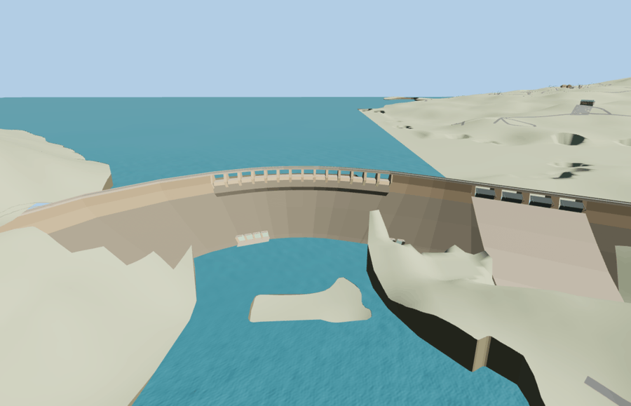

# Vanderkloof Dam

The model reproduces the 770 m curved crest road, fourteen ribbed overflow openings, four south-flank radial gates with distinct chutes, and six recessed lower outlet openings.

The signed crest follows the retained access roads at both abutments. The Earth viewer uses separate 1170.5 m reservoir and 1106 m tailwater surfaces. The four radial chute runs and the two southern outlet recesses sit above the fitted terrain. Both access roads meet the modeled deck at 1180 m at the sampled joins.

The Earth fixture retains 86 native road records and 23 nearby building features. The ground opening follows the concrete shell. Failed loading preserves the native layers. Eviction restores the ground and releases the model geometry.

| Detail level | Triangles | Download bytes | Draws |
| --- | ---: | ---: | ---: |
| skyline | 928 | 73,704 | 4 |
| district | 1,192 | 92,136 | 4 |
| street | 1,902 | 143,440 | 4 |
| closeup | 2,216 | 165,284 | 4 |

Skyline and district total 165,840 bytes. Six GLBs pass Khronos validation and contain zero embedded images. Three shared material graphs bind in the viewer. The review covers 77 renders and 500 geographic samples.

The tailwater and local bank grades are representative exterior estimates. The outer banks retain some sharp edges at coarse terrain resolution. Operating discharge and the underground generating station are outside the model.

The host supplies the matching Protomaps feature IDs and terrain samples fine enough to resolve the graded shoulders.

[Mapped site frame](map-frame.json) · [Terrain and water fit](site-fit.json) · [QA evidence](qa.json)
