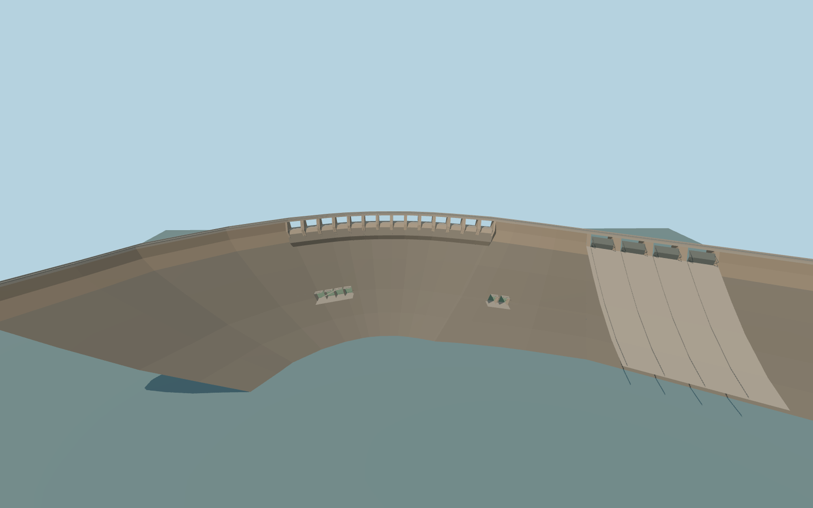

# Vanderkloof Dam

Vanderkloof Dam’s curved crest road, ribbed free-overflow apron, four radial gates on the south gravity flank, and lower outlet works on the Orange River.

Rebuild: `node packages/worldgen/scripts/generate-vanderkloof-dam.mjs`;append `--check` for exact source bytes. Select import/LOD/placement with `--ids=vanderkloof_dam`. Detailed source and four browser tiers are separate ignored GLB outputs.

The vertical origin is 1165.3184255 m. The crest road is fixed at 1180 m. The review water fixture uses 1170.5 m at full supply and an illustrative 1106 m below the dam.

The crest uses the mapped road and extrapolated land ties to reach the operator’s 770 m length. The subsurface section, exact rib and outlet dimensions, and closed gate positions are exterior approximations.

The raw terrain retains low anomalous samples, and its bank surface intersects portions of both outer wings. The 1170.5 m reference pool and representative sampled stages are separately recorded.

The asset depicts dry gates and spillways. The underground power station and canals stay in their native map context. Operating flows are outside its scope.

Original geometry:repository license. Map:© OpenStreetMap contributors,ODbL-1.0;Protomaps. Standard terrain:terrain-grid.json. Ordinary pictures stay local and are not redistributed or used as textures. Current acceptance:qa.json.
