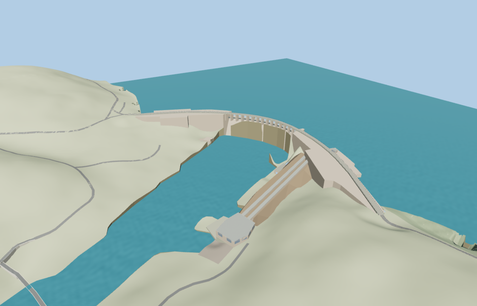

# Gariep Dam

Gariep Dam has the curved concrete arch, both gravity wings, fifteen open spillway bays and a level crest road. A fitted gravel bank supports the two covered runs to the generating hall. The paired low outlet mouths remain exposed.

The dam follows retained OSM way 174344884. Both ends of the crest meet the rendered tertiary road within 2 mm at the sampled points. The mapped reservoir and Orange River tailrace use representative stages of 1260.97 m and 1203.97 m.

The viewer replaces the mapped crest bridge and retains the two native approaches, the independent downstream crossing and the rest of the local road network. Failed loading restores all 14 transportation records. Unload restores ground and land cover and releases the model geometry.

| Detail level | Triangles | Download bytes | Draws |
| --- | ---: | ---: | ---: |
| skyline | 994 | 87,860 | 1 |
| district | 2,148 | 196,152 | 6 |
| street | 3,094 | 285,384 | 6 |
| closeup | 7,248 | 654,716 | 6 |

Skyline and district total 284,012 bytes. Six GLBs, four focused tests, 225 terrain and placement checks and 79 renders passed review.

The road grades, shore fit and water stages are estimates from retained PMTiles, Terrarium and exterior photos. Terrain repairs are bounded to the approaches, damaged samples and shoreline beside the lower works.

Steep native banks remain beyond the fitted works. The gravel terrace, outlet pipe proportions and operating stages are simplified exterior reconstructions.

[Mapped site frame](map-frame.json) · [Terrain and water fit](site-fit.json) · [QA evidence](qa.json)
