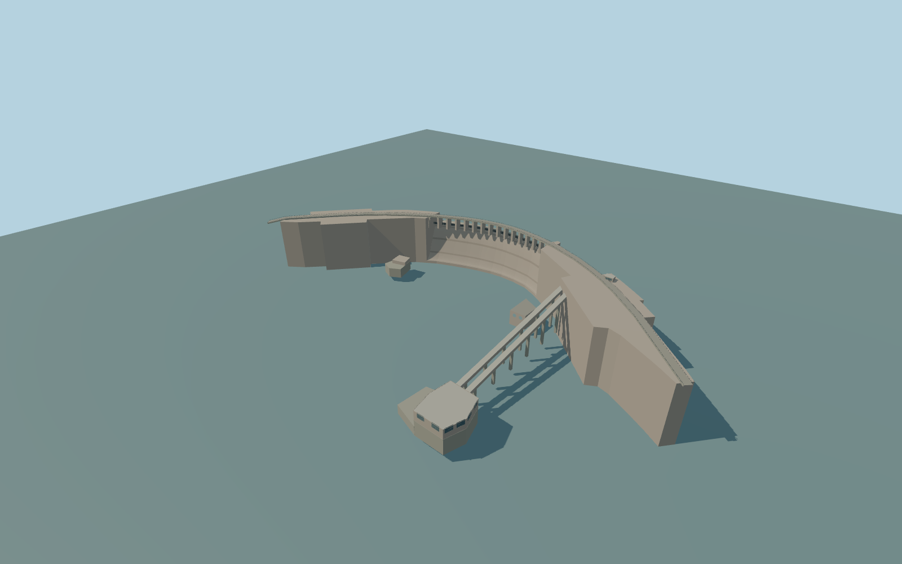

# Gariep Dam

Curved concrete arch, both solid gravity wings, fifteen visually interpreted spillway openings, continuous mapped crest deck, stepped side outlet, paired low round outlets, and the separate hydroelectric bank with two covered runs, raised powerhouse, and lower outlet portals.

Rebuild: `node packages/worldgen/scripts/generate-gariep-dam.mjs`;append `--check` for exact source bytes. Select import/LOD/placement with `--ids=gariep_dam`. Detailed source and four browser tiers are separate ignored GLB outputs.

Curved concrete arch, both solid gravity wings, fifteen visually interpreted spillway openings, continuous mapped crest deck, stepped side outlet, paired low round outlets, and the separate hydroelectric bank with two covered runs, raised powerhouse, and lower outlet portals.

The exact-Q dam outline and current crest bridge establish horizontal shape and facing. The named powerhouse location and two ordinary photographs control the approximate extent and features of the industrial bank. The retained 88 m height and 914 m length are distinct from the visible arch profile and sampled crest trace. One standard reservoir reference supplies the datum. Crest, sill, foundation, floor and tailwater levels are approximate.

The exact dam plan and signed terrain context are retained. The open bay count, visible powerhouse bank and outlets are photo interpretations. Powerhouse and side outlet floor plans, crest grades, operating reservoir level and concealed machinery remain approximate. The separate downstream bridge and all 29 independent native building components remain. Physical-device and dense-scene timings remain unmeasured.

Bounded near-dam tailwater correction follows only the retained Orange River polygon from the dam toe to local Z235. Standard terrain rises through this photo-visible water in the first reach. The clipped region leaves all mapped banks, islands, the downstream road bridge and the open river beyond the reviewed pool untouched. Water level is an illustrative estimate.

Original geometry:repository license. Map:© OpenStreetMap contributors,ODbL-1.0;Protomaps. Standard terrain:terrain-grid.json. Ordinary pictures stay local and are not redistributed or used as textures. Current acceptance:qa.json.
