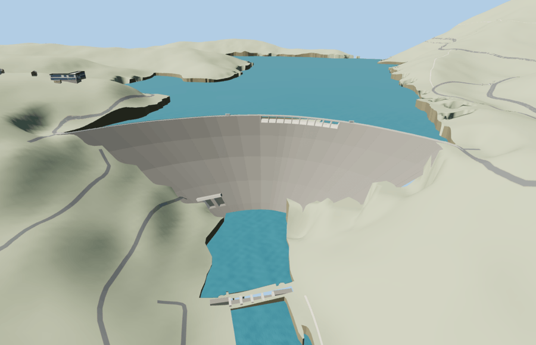

# Katse Dam

The model reproduces the 710 m double-curvature arch, ten open overflow bays under the crest road, paired low outlet recesses, crest houses and the separate lower dam.

The 2060 m crest follows the mapped road at both ends. The Earth viewer renders the 2053 m reservoir, 1901.4 m plunge pool and 1899.8 m tailwater as separate surfaces. The fitted eastern shoulder exposes the main arch above the gorge, with both low outlets, ten open overflow bays and the separate lower dam visible.

The Earth fixture retains 90 native road records and 31 nearby building features. The ground opening follows the concrete shell. Failed loading preserves the native layers. Eviction restores the ground and releases the model geometry.

| Detail level | Triangles | Download bytes | Draws |
| --- | ---: | ---: | ---: |
| skyline | 582 | 43,824 | 3 |
| district | 830 | 63,196 | 4 |
| street | 1,378 | 103,796 | 4 |
| closeup | 2,590 | 193,484 | 5 |

Skyline and district total 107,020 bytes. Six GLBs pass Khronos validation and contain zero embedded images. Four shared material graphs bind in the viewer. The review covers 76 renders and 320 geographic samples.

The authored road centerline is 706.4 m. The published 710 m describes the structure’s crest length. The terrain and lower water stages are representative estimates. The outer shore retains some sharp edges in coarse terrain.

The reservoir and stream stages require a host that serves the retained Protomaps feature IDs. The terrain correction needs samples fine enough to resolve the graded strips. Operating discharge and underground features are outside this exterior model.

[Mapped site frame](map-frame.json) · [Terrain and water fit](site-fit.json) · [QA evidence](qa.json)
