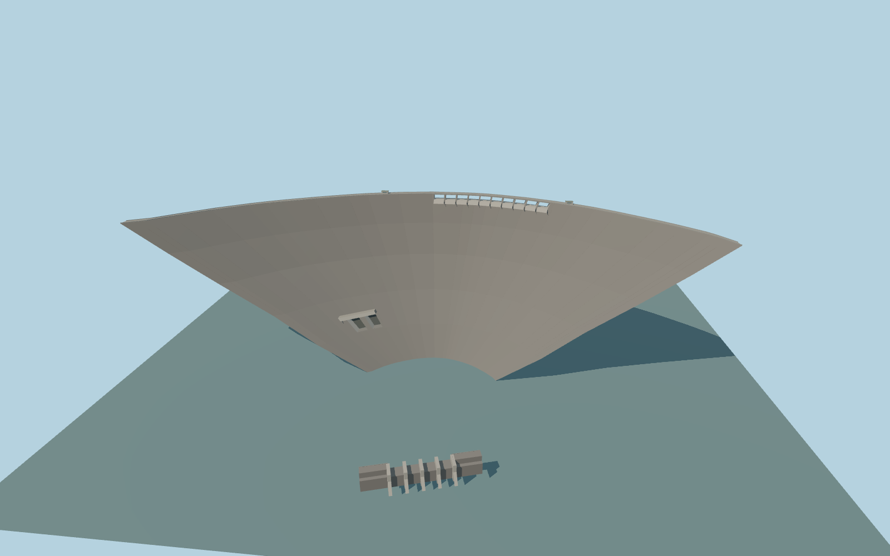

# Katse Dam

Katse Dam’s 710 m double-curvature crest, ten open overflow bays, paired recessed outlets, crest houses and separate lower dam across the Malibamat’so valley.

Rebuild: `node packages/worldgen/scripts/generate-katse-dam.mjs`;append `--check` for exact source bytes. Select import/LOD/placement with `--ids=katse_dam`. Detailed source and four browser tiers are separate ignored GLB outputs.

The signed vertical origin is 2055.506213125 m. The crest is fixed at 2060 m and the reservoir design fixture uses the operator’s 2053 m full-supply level.

The 679.34 m mapped crest centerline is extended at both road ties to reach the published 710 m arch length. The subsurface section, outlet geometry and lower dam elevations are reconstructed approximations.

The bounded ground opening exposes the spillway and low outlets. Coarse standard terrain still intersects the eastern downstream face and contains deep spurious samples near the reservoir.

The exterior model uses dry gates. Operating discharge and underground generation works are outside its scope.

Original geometry:repository license. Map:© OpenStreetMap contributors,ODbL-1.0;Protomaps. Standard terrain:terrain-grid.json. Ordinary pictures stay local and are not redistributed or used as textures. Current acceptance:qa.json.
