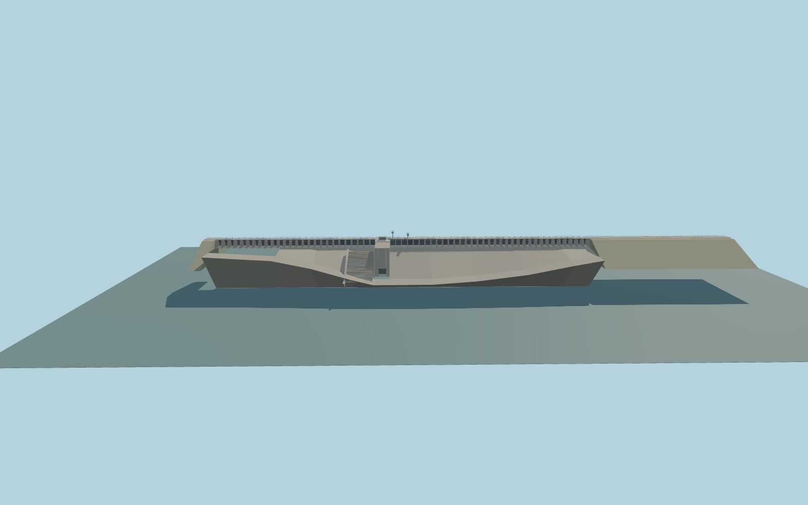

# Vaal Dam

Vaal Dam’s gravity wall and earthfill shoulders, with a 714 m service deck, 60 crest gates, the outlet tower and hoists, and the stepped downstream chute.

Rebuild: `node packages/worldgen/scripts/generate-vaal-dam.mjs`;append `--check` for exact source bytes. Select import/LOD/placement with `--ids=vaal_dam`. Detailed source and four browser tiers are separate ignored GLB outputs.

Fixed absolute datum 1485.988520375 m. The standard viewer sampler yields 1486.60 m upstream and 1454.10 m downstream. The modeled deck at 1493.3 m and 63 m structural wall depth are exterior approximations. The higher comparison uses the 1487 m storage servitude contour.

PMTiles supplies the reservoir and tailwater boundaries. The straight crest and outlet position fit the retained OpenStreetMap dam outline. Deck grade, individual gate spacing, foundation and flank sections are exterior approximations.

Both water fixtures preserve native shores away from the wall. The higher comparison uses a reference contour without implying an operating water level.

Scope covers the principal wall and visible outlet structures. Buried equipment, operating releases and the independent road bridge are outside the model.

Original geometry:repository license. Map:© OpenStreetMap contributors,ODbL-1.0;Protomaps. Standard terrain:terrain-grid.json. Ordinary pictures stay local and are not redistributed or used as textures. Current acceptance:qa.json.
