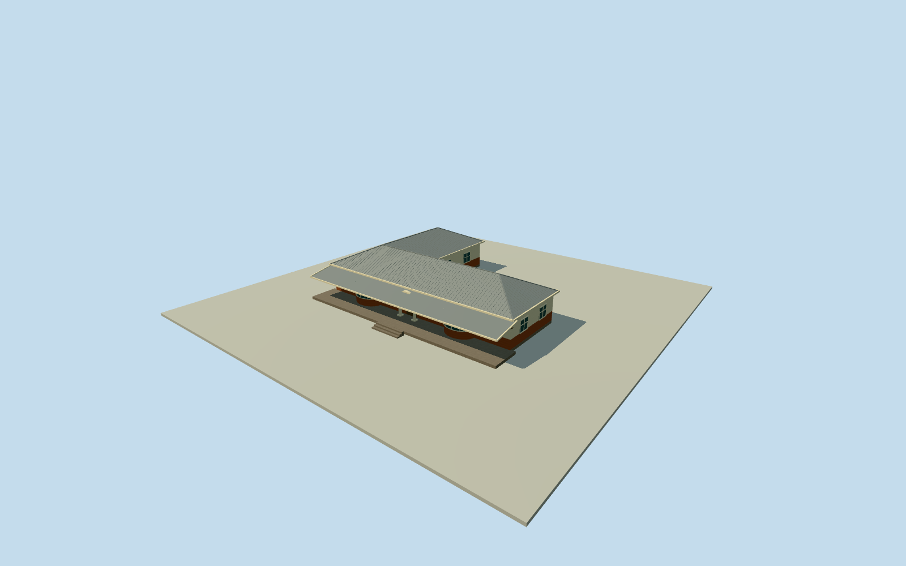

# Dr Xuma House — Empilweni

Complete original DrABXuma/Empilweni1935house at73TobyStreet, Sophiatown: full single-storey L-shaped residential/consulting-wing building, all exteriorwalls and complete corrugated-tin roof, curved front bay windows, arched entrance/plaincolumns, brick lowerwalls/plastered upperwalls, stoep and full-front bracketed lean-to canopy. Official tourism supplies one-storey/redbrick/tinroof/separate medicalwing/identity facts; architectural details are explicitly reported via the published account citing FloBird1991, not an unretrieved original plan. Exact published house point/Q20981521and original Toby/Edward frontage streets fix approximate site/orientation; no mapped original house footprint exists in saved native data. All plan lengths/widths/wing disposition, wall/roof/canopy/bay sections/census, finish and ground grade are bounded estimates. Separate new2015culturalcentre, detached garages/outbuildings/sitewalls/parking/gardens and interiors excluded; no campus proxy or photographic/survey claim. Every image/video/figure unused.

Authoring state: **review-in-qa.json**. Current completion evidence is in [qa.json](qa.json) and the [completion ledger](../../../../qualla-structures/batches/qualla-002.PROGRESS.md).

- [Dr Xuma House](https://qualla.com/dr-xuma-house/)

Complete original DrABXuma/Empilweni1935house at73TobyStreet, Sophiatown: full single-storey L-shaped residential/consulting-wing building, all exteriorwalls and complete corrugated-tin roof, curved front bay windows, arched entrance/plaincolumns, brick lowerwalls/plastered upperwalls, stoep and full-front bracketed lean-to canopy. Official tourism supplies one-storey/redbrick/tinroof/separate medicalwing/identity facts; architectural details are explicitly reported via the published account citing FloBird1991, not an unretrieved original plan. Exact published house point/Q20981521and original Toby/Edward frontage streets fix approximate site/orientation; no mapped original house footprint exists in saved native data. All plan lengths/widths/wing disposition, wall/roof/canopy/bay sections/census, finish and ground grade are bounded estimates. Separate new2015culturalcentre, detached garages/outbuildings/sitewalls/parking/gardens and interiors excluded; no campus proxy or photographic/survey claim. Every image/video/figure unused.

Official tourism verifies the original1935house is single-storey, red brick with corrugated tin roof and separate residence/medical wing. Published architectural account cites FloBird1991pp2/3 for Lplan, curvedbaywindows, plain-column archedentrance, brick-to-window-level/plasterabove, full-front bracketed lean-to canopy. The1991original report was not retrieved; no original drawing or survey claimed.

No mapped original-house footprint exists in the saved native source. The complete Lplan is a declared24x18m outer-extent reconstruction with24x8m main body and8x10m rear consultingwing; all lengths/widths/wing disposition/bay placement are estimates, with nominal20percent horizontal uncertainty, not source-measured values. Two original TobyStreet controls and two EdwardRoad controls supply geographic frontage/orientation context only; published house point fixes approximate location. Do not label those streets as the house outline or substitute the2015centre building.

Estimated floor0.45m provider-relative,3.2m wallheight,2.1m hiproofrise,0.4m eaves,1.05m brick wainscot, full25x3.1m stoep, two curved bays/radius1.7/depth1.3, glazing/sill/cornice/arch/columns/door/ordinary-window census, roof seams/corrugation, canopy profile/bracket census/finish are estimated. Height/roof uncertainties approximately0.5/0.8m. Whole mainroof is an original intersecting-hip reconstruction, not a source-measured1935roofplan. No exact verandah/bay census or current finish certification.

Full independent historic house: both whole residence/consultingwing masses and complete roofs, all exterior sides, intrinsic frontstoep/curvedbays/archedentrance/full lean-to canopy. Detached garages/outbuildings/2015centre/sitewall/parking/gardens/interiors excluded as separate objects. Medical equipment/room layout not modeled. No facade-only or campus proxy.

Original independent128m/16641height field with original tile, datum1732.9297m, acquired before all floor/main sections. Preserve original field/frame/floors/roof/sections; no terrain mask/flatten/cutout/reacquisition/refit or picture-driven changes. Provider canopy/house offsets mean geographicground contact and vertical registration remain approximate and unverified. Dated2013historical exterior reconstruction only, no automatic current-world replacement.

All images/figures/videos unused after Qualla-first10family search. Actual house photographCCBYSA and unrelatedPDAirport excluded; no image rights/media/article repairs. Written facts transmitted explicitly and all geometric estimates declared; no photographic appearance claim.

Build: `node content/worldgen/source/places/ke/ke7/dr_xuma_house/models/generate-house.mjs`. Add `--check` to verify exact regeneration. 7152 triangles; 6 materials; no embedded photographs.
