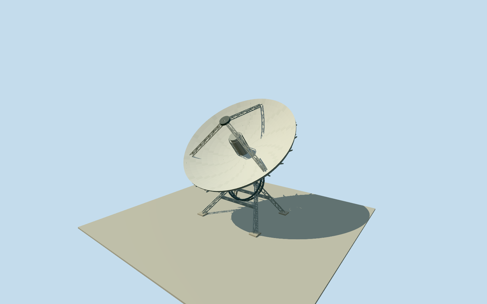

# HartRAO26m Radio Telescope

Principal26m HartRAO reflector at its specifically named native location: shallow white parabolic shell with central receiver, three open triangular feed trusses, rear radial webs/rings, inclined open polar/hour-axis framework and four splayed lattice legs with bounded concrete footings and an access ladder. Movable antenna shown in an illustrative observing pose; detached instruments and campus structures excluded.

Authoring state: **review-in-qa.json**. Current completion evidence is in [qa.json](qa.json) and the [completion ledger](../../../../qualla-structures/batches/qualla-002.PROGRESS.md).

- [Hartebeesthoek Radio Astronomy Observatory](https://qualla.com/hartebeesthoek-radio-astronomy-observatory/)

Native way220662077 explicitly identifies the26m IVS/VLBI telescope; its original polygon fixes the instrument center rather than the general campus/story point.26m diameter is retained. Surface focal ratio/depth,50degree display elevation, receiver, polar framework, truss sections and small fittings are photographic medium-fi estimates; this is not an engineering or tracking simulation.

Two inspected NASA GSFC photographs by named civil servant Frank Lemoine show the principal instrument during the2016VLBI meeting. Both exact offered900x550renditions, primary staff-role report and NASA government-work policy are hash-bound after a Qualla-first search. Original pixels are visual references and are not textures.

Principal26m structure only. Separate15m/XDM/C-BASS dishes, HIRAX array, laser-ranging equipment, campus buildings, containers, fences, landscape and branded labels are excluded. Fine webs/cage/ladder detail retires in lower LODs; the open mount and main feed/reflector silhouettes remain.

Footings extend0.35m below a fixed dry-pad datum. Source terrain, local foundation/pad attachment and ground slope remain approximate; no whole-site platform, blanket ground opening or source-height fitting is introduced.

Build: `node packages/worldgen/scripts/generate-authored-places.mjs --ids=hartrao_26m_antenna`. Add `--check` to verify exact regeneration. 15184 triangles; 3 materials; no embedded photographs.
