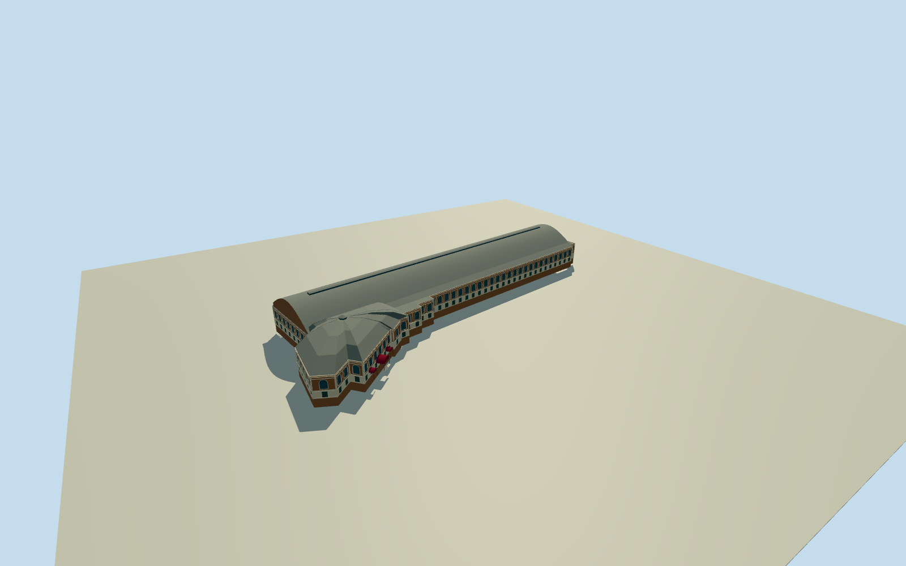

# Old Johannesburg Market — Market Theatre (2018)

Whole oldJohannesburgMarket physical building in2018, including the long steel-arched mainhall nowMuseumAfrica and intrinsic eastern CornExchange/IndianFruitMarket theatreannex/linkedstairs/serviceprojections. Whole native29vertexoutline846541435 withboth theatreQ1900656 andmuseumQ704439 POIs inside. Brick/creamVictorian elevations/recessedarchedglazing/rusticatedcorners/columns/burgundybarrelawnings. Fullroof/body/rear/sidebays/grade/sections are boundedestimates fromnativeoutline andprimary1913/1976hall-and-annexfacts, no exactsurveyclaim. Exclude distinctmodernMarketSquare604604639/othercitybuildings/squarelandscape/people/trees/vehicles/eventbranding/signlettering/interiors.

Authoring state: **review-in-qa.json**. Current completion evidence is in [qa.json](qa.json) and the [completion ledger](../../../../qualla-structures/batches/qualla-002.PROGRESS.md).

- [Market Theatre (Johannesburg)](https://qualla.com/market-theatre-johannesburg/)

Original wholeoldmarket29vertexway846541435; mappedMuseumAfrica node7138650719/Q704439 andtheatre node7138650728/Q1900656 insideit. Distinctmodernneighbor604604639 excluded. Signednorth-upframe +X east/+Z south; longhallworkingaxis follows native southlongwall, northeastannex/photoentryregistration andwholehiddensubdivisionsapproximate. Nativeoldoutline is not a roof/height/floor/section survey. Allcurrentreservedcandidates/collectionmembers/IDs/aliases clear.

Whole oldJohannesburgMarket physical building in2018, including the long steel-arched mainhall nowMuseumAfrica and intrinsic eastern CornExchange/IndianFruitMarket theatreannex/linkedstairs/serviceprojections. Whole native29vertexoutline846541435 withboth theatreQ1900656 andmuseumQ704439 POIs inside. Brick/creamVictorian elevations/recessedarchedglazing/rusticatedcorners/columns/burgundybarrelawnings. Fullroof/body/rear/sidebays/grade/sections are boundedestimates fromnativeoutline andprimary1913/1976hall-and-annexfacts, no exactsurveyclaim. Exclude distinctmodernMarketSquare604604639/othercitybuildings/squarelandscape/people/trees/vehicles/eventbranding/signlettering/interiors.

Wholeoriginalindependent512mfield BEFORE all floors/roof/sections/geometry; neverflatten/reacquire/reframe/refit afterrender.

Primaryold118ft/660fthall is historicalnamedspace, not a currentexactouterfootprint or mandate tostretch nativegeometry. Longmainhallsteelarch/easternCornExchange/annex established; hiddensubdivision/roofprofile/heights/baycensus/rearandgrade explicitly estimated.

Onlyclear2018officialUSgovernmentphoto adopted forvisiblebrick/cream/archedwindow/columns/awnings. No copiedlogos/signlettering/people/trees/vehicles/flags/eventbackdrops/interiors/protectedsiteimagery orphototextures.

Wholeoldmarketphysicalbuilding includes bothmainmuseumhall andintrinsicTheatreannex; namedPOIs/actualwhole29vertexoutline preserved. SeparatemodernMarketSquarebuilding excluded, no frontage-only proxy.

Primary1976text establishes longsteelthree-pinarchmarket hall/easternCornExchange/annex. Exactcurrentroofcurvature/clerestory/annexhip-dome/cupola/roofseams/sections/unseenrear and allheights explicitly estimated, no preciseasbuiltclaim. Mainhallnamedhistorical35.97x201.17m notusedtostretchnativecurrentbody.

Brick/creamquoins/roundheadedrecessedupperwindows/slenderroundcolumns/burgundybarrelawnings directlyguided byclear2018PDoriginal; full hiddenfacadebaycensus/stairdetails/registration estimated. No copiedlettering/eventbackdrops/flags/people/trees/streetclutter/phototextures.

Originalfieldrange1712.7607..1734.3366m/datum1721.6399m representscoarsemoderncompositecityrelief; rooftops/canopy/terrainartifacts/grade mayburylowerparts. No hostgroundcontactcertification, cutout/mask/flattening/reacquisition/fitting. Whole model reviewed isolated andwithoriginalfield.

Build: `node content/worldgen/source/places/ke/ke7/market_theatre_johannesburg/models/generate-house.mjs`. Add `--check` to verify exact regeneration. 34723 triangles; 6 materials; no embedded photographs.
