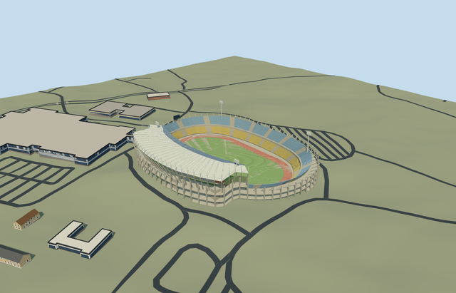

# N0723 — Royal Bafokeng Stadium

Reviewed 2026-10-20 in one continuous author/build/inspect/fix round.

## Appearance

Inspected48 current source/shared/sky-reflected medium-fi/native-Phokeng views in one ordinary-picture/PMTiles/build/inspect/fix pass. Own asymmetric oval envelope/field axis, low uncovered blue-yellow two-tier bowl and raised green west third tier/closed hospitality strip, concrete galleries/cores/rakers/recessed neutral services, single curved west cantilever roof/pale skin/narrow shared opaque glazed leading strip/renderable underside/radial framing/rear triangular masts and stays, terracotta athletics track/neutral lane marks/open football field/goals/supported north display/four floodlights are intact. Corrected slab side winding during construction; simplified distant cores/columns/track tessellation/light heads to meet skyline budget while retaining complete asymmetric mass. No annular roof, duplicate native stadium, copied lettering/ads/event crowd or missing side. Native slope can obscure portions of the retaining base; portable flat ground is separate from geographic evidence.

## Shared materials and browser levels

Four existing256-square graphs: concrete_plain, metal_painted, fabric_canvas and window_grid. Concrete supplies services/cores/decks/columns/common floor; paint supplies blue-yellow-green tiers/pale roof framing/trim/neutral displays/marks/lights; shared canvas supplies canopy/terracotta track/turf grain; window-grid supplies opaque hospitality glazing/leading roof strip. Roof and wall canvas slots make five near draws. Zero embedded images or unique atlas; every nearby graph read once. Metric UVs/linear palette conversion/separate POSITION and NORMAL buffers/equal reported CPU and GPU geometry bytes pass. Shared surfaces approximate metal/roof/track/glazing without bespoke imagery or exact optical transmission.

| Level | Triangles | Bytes | Draws |
| --- | ---: | ---: | ---: |
| skyline | 1000 | 89660 | 1 |
| district | 3778 | 326648 | 5 |
| street | 13034 | 1124840 | 5 |
| closeup | 58702 | 5219308 | 5 |

Inspected24 noon/late Economy/High street/block/skyline/silhouette/matched-level/transition frames with viewer sky reflections. All four levels retain own oval envelope/field axis/single west canopy/raised west tier/open track/two general seating bands. Near levels refine actual rows/aisles/rakers/stays/galleries/leading roof strip; far levels merge repetition, keep two representative cores/sparser exterior columns/simpler track curves/four floodlight silhouettes and omit subpixel framing. Declared skyline error allowance12m; other levels2/1.2/.25m. Initial skyline plus district416308bytes, below3MB phone/6MB laptop targets. Synthetic neighbors are not geographic evidence. Physical ordinary-laptop/phone/tablet/dense-city timings remain pending. Levels1000/3778/13034/58702 triangles; at most five draws.

## Approximate map fit

RetainedQ189337/named native stadium POI35184419067955 and named pitch35184433407267 identify Royal Bafokeng at parent52776559085418; no exact-QID map field. Own45-point outer/29-point hole give approximately240x199m body and187x116m inner opening. Separate117.1549433624701x66.79293956072114m pitch supplies own north-south axis; neutral105x68m field is distinct from that mapped surround. Anchor[27.16092020803335,-25.578775846126685]/heading0/native east-south/internal X[.004597658829575373,-.9999894307107885]/Z[.9999894307107885,.004597658829575373] puts the single canopy on the west. Sole parent fully removed/zero residual area; all15 independent resident inputs of16 originals retained byte-for-byte, all36 wider independent footprints of37 records disjoint from two-piece50mm-guard mask. Original6m grid/datum1174.9491419323049m/native roads/zero source water unchanged. Working common field floor0/individual retained support-core-light contacts/bounded opening within90percent body address original outer grade-3.1790362043959703..12.3336175408092m. Failure retains16 originals/original ground; every level unload restores ground/water/zero geometry. Plaza/school/indoor facilities/practice pitches remain native; no blanket site slab.

## Limits

Four ordinary photographs actually viewed: three ADO Architects gallery daylight west exterior/interior roof/wide west stand photos (individual photographers/date not supplied), plus Royal Bafokeng Stadium, Phokeng.jpg by2010 World Cup - Shine2010 dated2010-06-12/CC BY2.0 on Commons. Viewed only, no pixels/ads/logos/crowds copied. Native parent has no qualified architectural height. Working field0/low tiers1.4..9 and12..21m/west middle12..18m/hospitality18..22m/west green third22..31m/roof rear37.5..39.3m and leading edge+.8m/rear mast7m above canopy/floodlight44m/display25..30.5m/core cap23.7m are picture-led allocations. Eight-lane track uses84m straight/radii39..49m; visualization is not a certified400m running track. Four core/light placements, roof-frame/row/aisle/lane inventory/fine20degree/2m facing are estimates, not surveyed counts. Shared opaque glazing/roof does not reproduce original transmission; static geometry does not certify engineering/access/hidden furnished rooms/current condition. Undated/construction-era architect images and2010 event photo do not establish later changes. Coarse DEM/contact/bounded opening are visual controls, not a site survey. Physical ordinary-laptop/phone/tablet/dense-city timings remain pending.

## Selected checks

Six Khronos files: zero errors/warnings.14899 actual mesh/material/contact checks; 48 current inspected views. Scene validation/sim30 and strict selected medium-fi audit pass. Source/runtime/LOD hashes and material bindings verified.

Rebuild: node packages/worldgen/scripts/generate-additional-landmarks.mjs --ids=N0723; node packages/worldgen/scripts/import-next-1000-models.mjs --ids=N0723; node packages/tooling/scripts/generate-landmark-lods.mjs --ids=N0723 --force.

Source: sha256:e502f9c0191cf45de73eae4c7b1294b0d4542013bd0bad936186d674cce6956e

Runtime: sha256:8a11f09f5e4b79e75e8ccc22f0e8b9d3cfe1b488ee6103508e76759f97b364ef

Input: sha256:34c8abf864d96bb730f9e83359929a4ae561be5c4ad9c60564f606fffb4908f2

## Viewed ordinary pictures

https://www.ado-architects.com/copy-of-royal-bafokeng-renovation — https://static.wixstatic.com/media/592f5f_431dbaaebc17447c95f258807c9ffcf6~mv2_d_3264_2448_s_4_2.jpg; ADO Architects gallery; individual photographer not named; Copyright retained; viewed only/no pixels copied. Viewed only; no pixels copied.

https://www.ado-architects.com/copy-of-royal-bafokeng-renovation — https://static.wixstatic.com/media/592f5f_8c806051e2a84b968a24af01b7fdf119~mv2_d_1200_1800_s_2.jpg; ADO Architects gallery; individual photographer not named; Copyright retained; viewed only/no pixels copied. Viewed only; no pixels copied.

https://www.ado-architects.com/copy-of-royal-bafokeng-renovation — https://static.wixstatic.com/media/592f5f_1fb5b7b48b014f7eb13605720de9ba30~mv2.jpg; ADO Architects gallery; individual photographer not named; Copyright retained; viewed only/no pixels copied. Viewed only; no pixels copied.

https://commons.wikimedia.org/wiki/File:Royal_Bafokeng_Stadium,_Phokeng.jpg — https://upload.wikimedia.org/wikipedia/commons/6/67/Royal_Bafokeng_Stadium%2C_Phokeng.jpg; 2010 World Cup - Shine 2010; CC BY2.0; viewed only/no pixels copied. Viewed only; no pixels copied.
