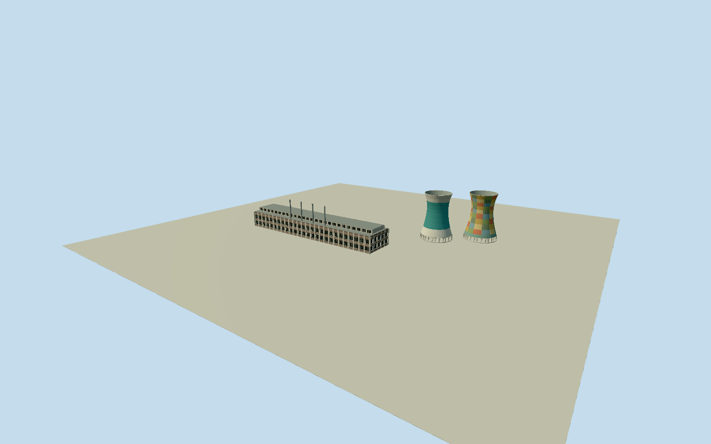

# Orlando Power Station

Complete representative2007principal Orlando Power Station exterior: whole long mainplant building on original native footprint, full roofmonitor/facade/wings and allfour intrinsic narrow chimneys, plus both whole legged/hollow hyperboloid cooling towers at their original native centers/footprints. Historical-only: original mainbuilding collapsed2014. Exclude post2009bungee/bridge/cage/newvenues, later ruins/redevelopment, lake/reservoir/grounds/pylons/rail/vehicles/people and detached utility buildings. No two-tower-only substitute or restored operating interior. Retain originalwhole native mainplant/two towerbase dimensions and relative spacing. Mainplant is roughly40mtall/fourstacks roughly70mfrom photograph proportions; refine plausible section within the old full exterior, not a generic opaque plant block. Repeated dark recessed/open facade bays in concrete bands, low long clerestory/openmonitor, 4slenderstackslots nearfront. Two original90mnativeheight towers must have true hollow open tops/rims, narrowing neck and open lower supported intakes; no capped solidcones. Preserve towerconcrete/radius profiles and bounded broad paint fields without exact mural/brand/lettering copies. Hidden rear/roof/brick/window/stack/paintcensus bounded. Original2007phase means no bungeebridge installed2009; do not borrow later licensedphoto pixels for unseen machinery. Freeze independent1000mfield at fixed original frontbank before geometry; historical/site grade/hostattachment remains unverified.

Authoring state: **review-in-qa.json**. Current completion evidence is in [qa.json](qa.json) and the [completion ledger](../../../../qualla-structures/batches/qualla-002.PROGRESS.md).

- [Orlando Power Station](https://qualla.com/orlando-power-station/)

Exact named mainplantway171672274/Q15264334 original4vertex outline and original two37vertex cooling-tower footprintsways171672273/171672272; no arbitrary parcel/tower placement. Existing mainplant geometry is now taggedruins; it is registration/control for2007reconstruction, not evidence of present intact survival. Fixed+XSEalonglongmainhall,+ZSWtowardOrlandoDam/frontphoto,+Yup; original northwest-front footprint corner fixed as ground datum before terrain/geometry. Both native towerheights90m retained; story/operatorapprox100m not used to stretch native geometry. Mainheight/stacksection/hiddenrear elevations and pre2014roof/bay partitions remain bounded photographic estimates.

Complete representative2007principal plant exterior, allfour narrow chimneys and both whole cooling towers. Original mapped mainplant footprint and all tower base controls retained in detailed geometry. Native towerheight90m, photographic mainhall40m/fourstack70m, facade/monitor sections and neck/rim/leg shapes bounded. Mainhall has real recessed bays at district/street/closeup; skyline uses flat window cues. Tower tops/interiors/intakes remain truly hollow/open at everyLOD, no capped solidcones.

Two exact published Qualla originals individually inspected/nativeSHA1matched: Exasbartos2007ownPD-self3648x2432frontplant/towers and TimGiddings2004ownPD-user-en1280x960wholeplant/fourchimneys/towers. Original whole structure is historical-only because primaryNRCSregulator reports confirm collapse25June2014.2007is a representative viewing year, not an exact exposure day; valid2007-01-01until2008-01-01/currentWorldEligible=false. No2009bungeebridge/cage or later redevelopment borrowed from licensedphotographs.

Original broad teal/white and varied earth/green/blue painted fields evoke the cleared historical exterior; exact mural/advertisement/logo/lettering designs are not copied or represented as accurate. Paint census/current artwork, exact facade bay/brick/glazing census, hidden rear roofs/services/foundation and fine chimney/leg sections are photographic estimates. No original artist texture/photo/generatedbitmap/downloadedmesh used.

Current native mainplant footprint is taggedruins and supplies original plan registration only. This asset includes the complete old mainplant, rather than a two-tower-only substitute; it is not eligible for default current-world placement. Detached modern utility/entertainment buildings, museumclockartifact, lake/water/roads/railways/pylons/grounds/people/vehicles and interiors/machinery excluded; no whole-site floor.

Independent1000m129x129field/16641samples/4rawTerrariumtiles frozen at original northwestfrontcorner, datum1629.6835m, unchanged. Implausible negative inland/lake samples to-8231.2297m are diagnostic evidence only and never control geometry or historical yard/water levels. Portable/shared/context use separate flat review ground. Exact historical grade/footings/thresholds and compatible live host attachment unverified; dated placement only/replaceFootprint=false.

Build: `node packages/worldgen/scripts/generate-authored-places.mjs --ids=orlando_power_station`. Add `--check` to verify exact regeneration. 28212 triangles; 5 materials; no embedded photographs.
