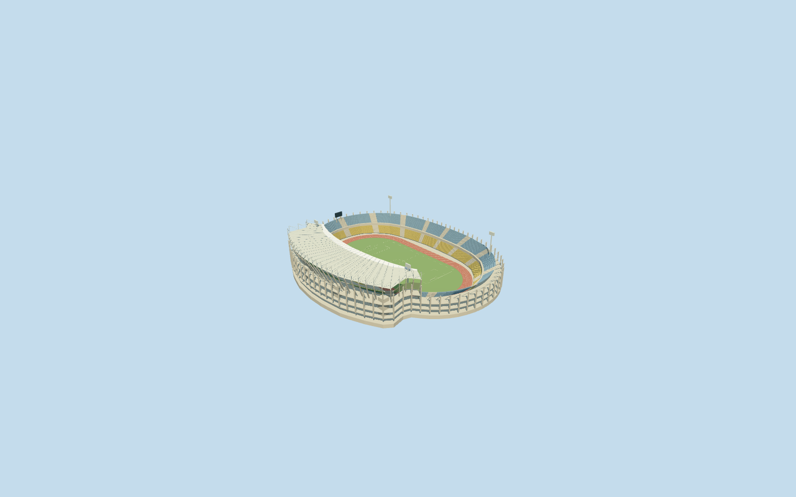

# Royal Bafokeng Stadium

Specific Royal Bafokeng Stadium: own asymmetric oval envelope/field axis, low uncovered blue-yellow two-tier bowl, taller green west third tier/closed hospitality strip/concrete galleries/cores/rakers/recessed neutral services, single curving west cantilever canopy with pale opaque skin/narrow shared opaque glazed leading strip/renderable underside/radial framing/rear triangular masts and stays, terracotta athletics track/neutral lane marks/open football field/goals, supported north end display and four local floodlight columns. Four shared material graphs, no copied photographs/seat lettering/ads/temporary works/crowd, no annular roof or surrounding plaza slab. Far levels merge repeated rows/framing but retain asymmetry and open track.

## Evidence and reconstruction

Published dimensions and reconstructed details are separated in spec.json. Primary references:

- [Reference](https://www.ado-architects.com/copy-of-royal-bafokeng-renovation)
- [Reference](https://commons.wikimedia.org/wiki/File:Royal_Bafokeng_Stadium,_Phokeng.jpg)

Specific Royal Bafokeng Stadium: own asymmetric oval envelope/field axis, low uncovered blue-yellow two-tier bowl, taller green west third tier/closed hospitality strip/concrete galleries/cores/rakers/recessed neutral services, single curving west cantilever canopy with pale opaque skin/narrow shared opaque glazed leading strip/renderable underside/radial framing/rear triangular masts and stays, terracotta athletics track/neutral lane marks/open football field/goals, supported north end display and four local floodlight columns. Four shared material graphs, no copied photographs/seat lettering/ads/temporary works/crowd, no annular roof or surrounding plaza slab. Far levels merge repeated rows/framing but retain asymmetry and open track.

## Model and axes

58,702 triangles; 176,106 vertices; 5 material groups; 7,047,668 bytes. Native bounds: -109.460, -3.679, -120.663 to 88.095, 46.369, 117.160. Source hash: `sha256:e502f9c0191cf45de73eae4c7b1294b0d4542013bd0bad936186d674cce6956e`.

{"x":"east","y":"up","z":"south"}

The geographic proposal uses exact-QID OpenStreetMap evidence. Map-derived orientation and estimated architectural details require real-site visual review; preview eligibility is distinct from geographic/fidelity approval. Map attribution: © OpenStreetMap contributors, ODbL-1.0.

## Reproduce

Run `node packages/worldgen/scripts/generate-additional-landmarks.mjs --ids=royal_bafokeng_stadium` (or add `--check`). The generator preserves manually edited masters by checking their baseline hashes. Import through the standard authored-model workflow with optimization disabled; then capture all QA cameras, including shared-surface views.

## Pending work

- Specific Royal Bafokeng Stadium: own asymmetric oval envelope/field axis, low uncovered blue-yellow two-tier bowl, taller green west third tier/closed hospitality strip/concrete galleries/cores/rakers/recessed neutral services, single curving west cantilever canopy with pale opaque skin/narrow shared opaque glazed leading strip/renderable underside/radial framing/rear triangular masts and stays, terracotta athletics track/neutral lane marks/open football field/goals, supported north end display and four local floodlight columns. Four shared material graphs, no copied photographs/seat lettering/ads/temporary works/crowd, no annular roof or surrounding plaza slab. Far levels merge repeated rows/framing but retain asymmetry and open track.
- RetainedQ189337 reference/named native stadium POI35184419067955 and named own pitch35184433407267 identify Royal Bafokeng at parent52776559085418. No exact-QID field in extract. Own45-point outer/29-point hole give approximately240x199m body and187x116m central opening. Separate pitch117.1549433624701x66.79293956072114m supplies the independent north-south axis. Anchor[27.16092020803335,-25.578775846126685]/heading0/native east-south/internal X[0.004597658829575373,-0.9999894307107885]/Z[0.9999894307107885,0.004597658829575373]. Neutral105x68m field is distinct from mapped pitch surround. West roof/third-tier placement follows actual ordinary photographs with20degree/2m fine-facing estimate.
- No qualified architectural height in native parent. Working field0/low tiers1.4..9 and12..21m/west middle12..18m/closed hospitality18..22m/west green third22..31m/roof rear37.5..39.3m and leading edge+.8m/rear mast7m above roof/floodlight44m/end display25..30.5m are picture-led allocations. Track capsule straight84m/radii39..49m approximates the visible running track inside native opening, not certified400m track geometry. Four concrete cores, roof-frame counts, row/lane/aisle placement and fine facing are approximate. Shared roof/glazing is opaque, not exact optical transmission. Architect photographs undated;2010 match photograph establishes that era, not current condition. No hidden furnished rooms/access or engineering certification.
- Original6m Mapzen samples/native roads/water/all36 independent resident buildings unchanged. Working occupied field floor0 uses original anchor datum1174.9491419323049m. Original outer grade spans-3.1790362043959703..12.3336175408092m above anchor; all support/cores/floodlight contacts use their own retained original samples. Common retaining floor and bounded opening within90percent body/all-level supported floor handle coarse DEM without editing samples or outside ground. Only own parent replaced. Surrounding plaza/school/indoor facilities/practice pitches remain native. Failure/unload retain or restore original context.

This bundle follows the medium-fi standard. Medium-fi appearance and geographic fit are reviewed separately. Hash-bound visual acceptance is recorded separately after capture inspection.
