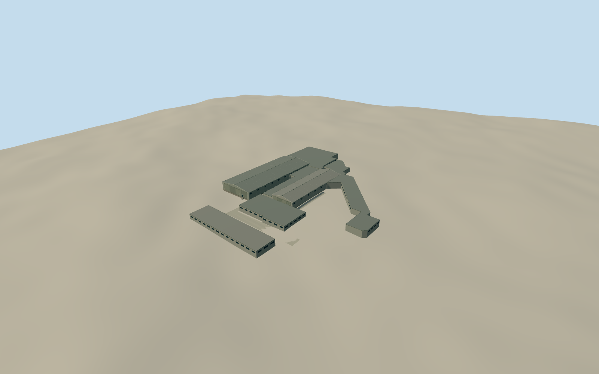

# Ditsong National Museum of Military History

Ditsong’s military museum in Saxonwold, including the two original Bellman exhibition hangars, attached ranges, the Masondo Library and open paths between the buildings.

Authoring state: **review-in-qa.json**. Current completion evidence is in [qa.json](qa.json) and the [completion ledger](../../../../qualla-structures/batches/qualla-003.PROGRESS.md).

- [South African National Museum of Military History](https://qualla.com/south-african-national-museum-of-military-history/)

The major roof ranges follow Microsoft and Overture footprints. Both original Bellman halls are documented. The allocation of their roof sections within these merged footprints remains an exterior reconstruction.

Roof heights, the transition between original and later roof ranges, door alterations, windows, colors and finished floor heights are estimates. The building forms use the published South African Bellman type.

The open paths and named library follow available map controls. The collection interiors, outdoor military objects and the separately sited war memorial are outside the model.

Build: `node content/worldgen/source/places/ke/ke7/south_african_national_museum_of_military_history/models/generate-south-african-national-museum-of-military-history.mjs`. Add `--check` to verify exact regeneration. 2944 triangles; 6 materials; no embedded photographs.
