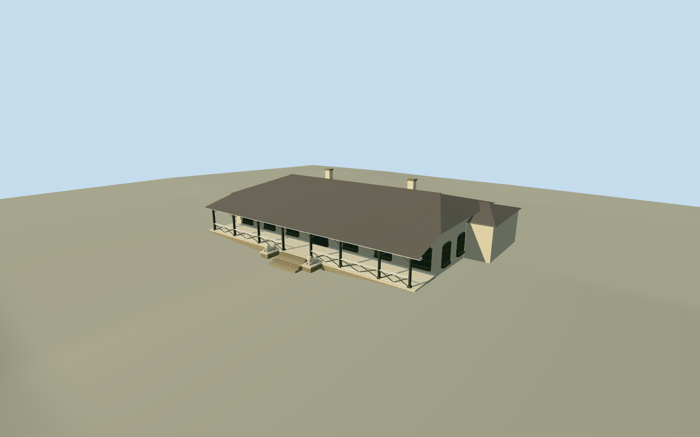

# Kruger House, Pretoria

The Pretoria house museum with its broad one-storey street front, iron-bracketed stoep and pair of stone lions.

Authoring state: **review-in-qa.json**. Current completion evidence is in [qa.json](qa.json) and the [completion ledger](../../../../qualla-structures/batches/qualla-004.PROGRESS.md).

- [Kruger House, Pretoria](https://qualla.com/kruger-house-pretoria/)

Draft exterior: approximate photographic proportions and simplified ornament. It is not a survey, photogrammetric reconstruction or approved current geographic replacement.

The native Underwood and Underwood photograph shows the original low veranda, spaced supports, X-pattern railings and symmetric central entry. The museum documents the lion pair and south placement.

Terrain sampling/contact, geographic alignment and site activation remain pending. Runtime LODs are produced by the registered after-import pipeline and require visual review.

Reference photos remain in the local Qualla corpus; only provenance, paths and hashes are retained here.

Build: `node content/worldgen/source/places/ke/kek/kruger_house_pretoria/models/generate-kruger-house-pretoria.mjs`. Add `--check` to verify exact regeneration. 2030 triangles; 6 materials; no embedded photographs.
