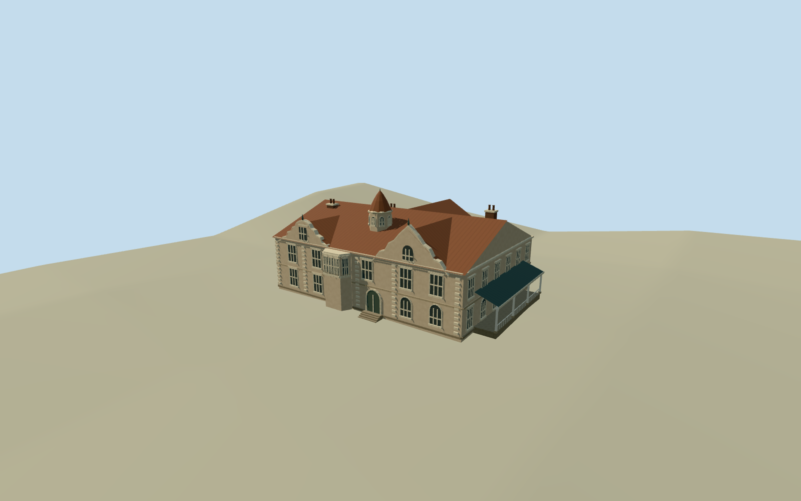

# Melrose House

The park-facing Victorian mansion with paired shaped Dutch gables, a pointed turret, brick chimneys, glazed bay and side verandas.

Authoring state: **review-in-qa.json**. Current completion evidence is in [qa.json](qa.json) and the [completion ledger](../../../../qualla-structures/batches/qualla-004.PROGRESS.md).

- [Melrose House](https://qualla.com/melrose-house/)

Draft exterior: approximate photographic proportions and simplified ornament. It is not a survey, photogrammetric reconstruction or approved current geographic replacement.

The Sallo Epstein postcard records the sculpted twin gables, asymmetrical roof, glazed bay, pointed roof lantern and masonry chimneys of the historic north elevation.

Terrain sampling/contact, geographic alignment and site activation remain pending. Runtime LODs are produced by the registered after-import pipeline and require visual review.

Reference photos remain in the local Qualla corpus; only provenance, paths and hashes are retained here.

Build: `node content/worldgen/source/places/ke/kek/melrose_house/models/generate-melrose-house.mjs`. Add `--check` to verify exact regeneration. 7902 triangles; 6 materials; no embedded photographs.
