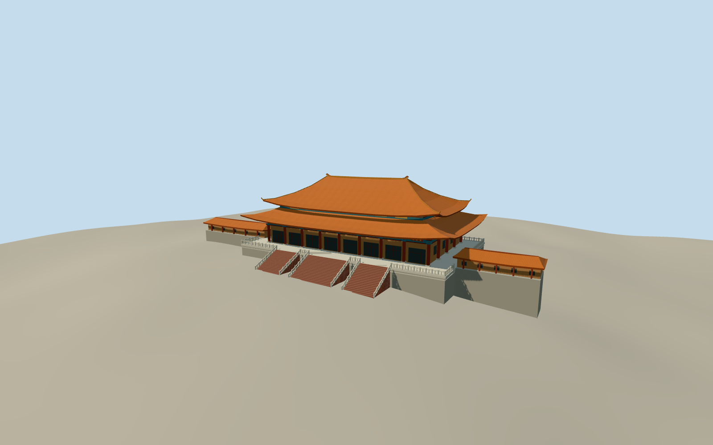

# Nan Hua Temple Main Shrine

Nan Hua Temple’s principal shrine around March 2006, with its two curved orange tiled roofs, painted bracket bands, red columns and broad balustraded stone platform.

Authoring state: **review-in-qa.json**. Current completion evidence is in [qa.json](qa.json) and the [completion ledger](../../../../qualla-structures/batches/qualla-003.PROGRESS.md).

- [Nan Hua Temple](https://qualla.com/nan-hua-temple/)

The principal shrine is represented around the 2006 upload date. Exterior section heights, off-camera elevations, stair counts and rail motifs are visual estimates.

The unchanged provider terrain is a composite ground surface. It drops below the raised podium at the rear and north side. The stair feet are approximated against that field. Detached buildings and precinct walls are excluded.

Build: `node content/worldgen/source/places/ke/kek/nan_hua_temple/models/generate-nan-hua-shrine.mjs`. Add `--check` to verify exact regeneration. 10840 triangles; 5 materials; no embedded photographs.
