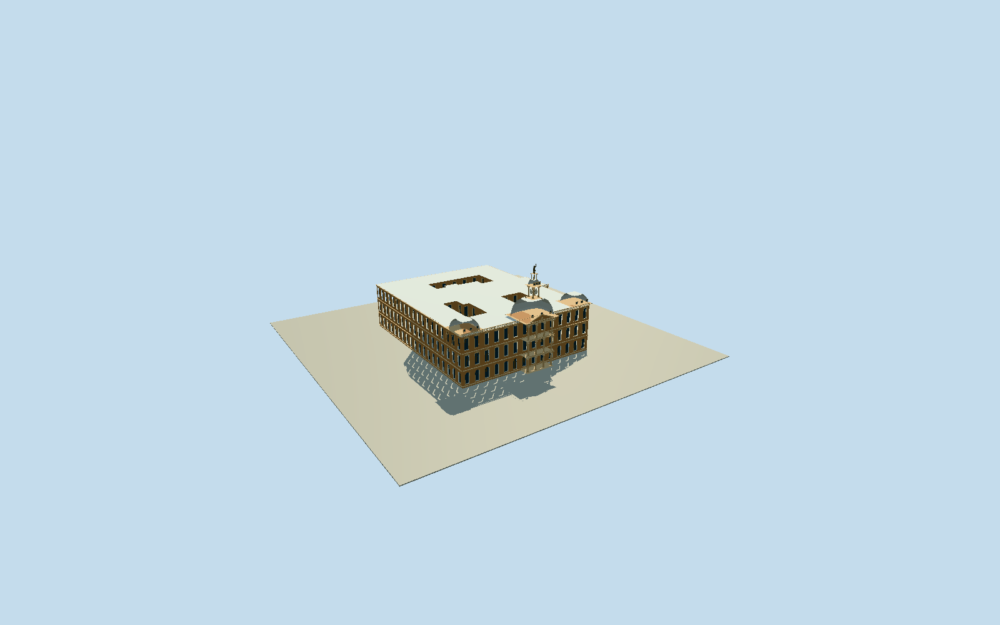

# Ou Raadsaal, Pretoria

Whole surviving Ou Raadsaal old parliament/council building explicitly described in the ChurchSquarestory: exact complete13vertex outerbuilding and all three4/6/10vertex courtyard holes, three sandstone storeys, full north facade/colonnaded portico/pediment, two end mansardcaps and central larger mansard/clocktower/lantern/allegorical figure, whole side/rear wings and courtyard-facing walls/roofs. This is a named building model, not a model of the entire public square. Exclude PalaceofJustice, Krugermonument, Capitol/GPO/neighboringblocks, square retainingwall/underpass/paving/trees/posts/flags/vehicles/people, rooms and detached civic structures. Keep complete wholebuilding/courtyard geometry, not a detached frontage. Centralportico derives native4.1mprojection and12mwidth; frontthreecolonnadestoreys/centraltriangularpediment, three rounded rectangular mansardcaps and central openclockcupola/lantern/figure silhouette. Long warmashlar wings and cornerpavilions: archedgroundwindows/segmentalupperpediments, thinprominentcornices and balustrades. Detailed real recesses/porticovoids/clockfaces; no texture-only flatphoto. Rear/side/courtyard facades, roofs and heightpartitions are bounded photographic estimates, original courtholes must remain physically open allLODs. No PalaceofJustice twin towers or foreground square underpass. Fixed localfrontapproach before400mterrain; preserve rawfield without fit/flatten/reacquire.

Authoring state: **review-in-qa.json**. Current completion evidence is in [qa.json](qa.json) and the [completion ledger](../../../../qualla-structures/batches/qualla-002.PROGRESS.md).

- [Church Square, Pretoria](https://qualla.com/church-square-pretoria/)

Exact named OSMrelation10095211/Q302422: all13original outerway433820436vertices and all three original courtyard holesways729799719(4),729799720(6),729799721(10). Full relation fetched, not cropped map missing the southern courtyard. Anchor at original front centralportico northcorners midpoint; heading from original fullfront baseline corner0to6. Fixed+Xalongfront towardeast/+Zsouthtowardrear/+Yup; no idealized rectangle/filledcourtyards or use of camera coordinate as building center. Native centralportico projection controls actual width/depth; three-storey heights, domedcaps/tower/hiddenrear roof and facade rhythms are bounded photographic estimates, not a surveyed restoration.

Whole surviving namedOuRaadsaal, not ChurchSquareplaza or PalaceofJustice. Complete original outer13vertices/three4+6+10vertexcourtyard holes retained, open native frontportico footprint. Principal3storey18.5mbody/38mapex, three roundedmansardcaps/centralclockcupola/lantern/allegoricalsilhouette, porticocolumns/pediment/balconies and repeated facadebays are photographic estimates. Native mapping fixes complete geometry in plan; rear/courtyard/roof heights/sections and detailed fenestration/ornament census are not surveyed.

Qualla-first39publishedfamilies checked. One exact4823x3215namedlumoplankcreatorCC0original inspected/nativeSHA1matched; primary Flickrphoto54445014179/immutableNSID199350666@N08/CC0dedication bound. Original caption erroneously names PalaceofJustice; actual centralclock/three-cappedOuRaadsaal identity independently tied to named native southside building and municipal heritage text. No sibling/upstream metadata edited and no uncertain grant adopted. No attributionphoto/agencyimage/diagram/phototexture/generatedbitmap/downloadedmesh.

Detailed levels have true window recesses/glassbackings and physically open colonnaded portico/courtyards/clocklantern; skyline/district simplify windows into flat architectural cues and the skyline clockbody is solid. Capitals/cornice/roof dormers/balustrade/sculpture silhouette and clock hands are original bounded medium-fi interpretations, not exact artist-carving digitization or currentmechanismstate.

The sourcephoto foreground retainingwall/underpass belongs to the square and is excluded. PalaceofJustice/twin corner towers, centralKrugermonument, GPO/OldCapitol/adjacentblocks and streets/plaza/plantings/people/vehicles/flags/post props are separate unrepresented story structures; this asset does not claim to complete the entire square. No whole-site base or roominteriors.

Independent400m129x129field/16641values frozen at native northapproach before geometry, original source values/raw tilebytes unchanged. CompositeurbanDEMmay include building/vegetation returns and is not surveyed threshold/groundheight. Portable/shared/context use separate flatreviewstage; actual approach/footing/courtyard/hostterrain contact remains approximate geographicpreview/replaceFootprint=false.

Build: `node packages/worldgen/scripts/generate-authored-places.mjs --ids=ou_raadsaal`. Add `--check` to verify exact regeneration. 20448 triangles; 6 materials; no embedded photographs.
