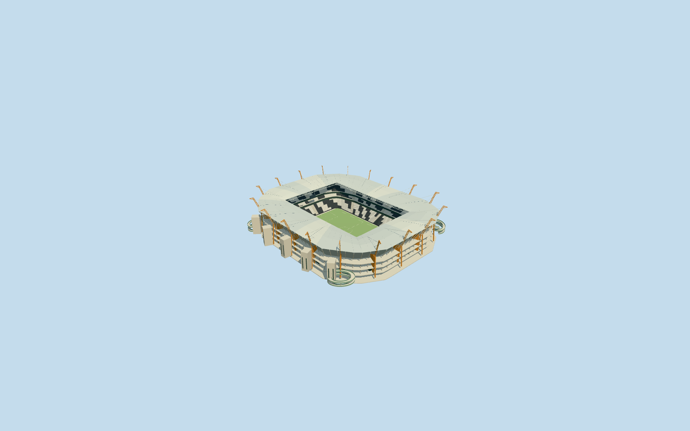
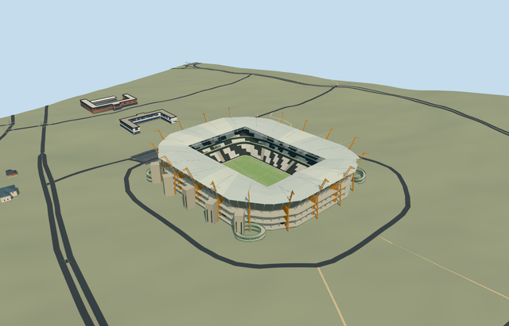

# mbombela_stadium — Mbombela Stadium

Reviewed 2026-10-20 in one continuous author/build/inspect/fix round.

## Appearance

Inspected48 current portable/shared/sky-reflected medium-fi/native-Mbombela views in one ordinary-picture/PMTiles/build/inspect/fix pass. Own clipped rectangular envelope/open rectangular roof aperture,18 orange giraffe mast silhouettes and nearby lattice/closed lower fins/short heads/roof stays, pale grey-cream canopy/renderable underside/deep inner truss/radial steel/open ventilation gap, recessed concrete-glazed services/concourse bands/ten access cores, four green curved two-turn corner ramps/guards/supports/arrival links, three zebra seating bands/two closed circulation belts/pale aisles/open neutral football floor and supported displays/lights/goals are intact. Corrected sloping ramp underside diagonals/support heights and coarse head silhouette caps before acceptance. No duplicate native stadium or missing side. Neutral irregular dark-light seating patches, no copied lettering/logos. Portable flat ground is separate from original native terrain; some lower ground can be occluded by native slope.

## Shared materials and browser levels

Four existing256-square graphs: concrete_plain, metal_painted, fabric_canvas and window_grid. Concrete supplies cores/decks/supports/common floor; tinted paint supplies orange masts/green ramps/zebra tiers/pale steel/trim/neutral displays/marks/lights; shared canvas supplies pale canopy and turf grain; window-grid supplies opaque recessed glazing. Separate roof/wall canvas slots create five near draws. Zero embedded images or unique atlas; every nearby graph read once. Metric repeats/linear palette conversion/separate POSITION and NORMAL uploads/equal reported CPU and GPU geometry bytes pass. Shared opaque fabric/glazing approximate surfaces without bespoke image textures or original optical transmission.

| Level | Triangles | Bytes | Draws |
| --- | ---: | ---: | ---: |
| skyline | 940 | 93188 | 1 |
| district | 3986 | 378096 | 5 |
| street | 15778 | 1505456 | 5 |
| closeup | 53342 | 5213928 | 5 |

Inspected24 noon/late Economy/High street/block/skyline/silhouette/matched-level/transition frames with viewer sky reflections. All four levels retain own envelope/field axis/open football field/pale canopy/orange mast heads/green ramp locations/three-band bowl. Near levels refine neck lattice/fins/stays/steel/actual zebra treads/cores/glazing/curved ramps. Far levels merge repetition, simplify closed head silhouettes and ramp masses; skyline expands seating opening with declared12m error allowance. Initial skyline plus district471284bytes is below3MB phone/6MB laptop targets. Synthetic neighbors are not geographic evidence. Physical ordinary-laptop/phone/tablet/dense-city timings remain pending. Levels940/3986/15778/53342 triangles; at most five draws.

## Approximate map fit

RetainedQ187087/earlier mappedway52908226 reference/named native stadium POI35184424997058 establish Mbombela at both overlapping parents52776558590422/52776560443840; no exact-QID map field. Both share12-point approximately219x178m clipped outer. Smaller8-point stand hole and larger4-point133x90m canopy aperture remain distinct. Separate own pitch35184545102673 supplies99.8686193996624x57.73958892200571m mapped axis, not forced international field scale. Own anchor[30.929697453975677,-25.461735381949467]/heading0/native east-south; internal X[.2564863071015519,-.9665478644482167]/Z[.9665478644482167,.2564863071015519]. Working118x80m rounded lower opening retains complete neutral105x68m field. Both owned parents fully removed/zero residual record or area; all10 independent resident inputs of12 originals/wider12 records unchanged and disjoint from two-piece50mm-guard mask. Original6m samples/native roads/zero source water unchanged. Original datum696.0192718598134m/individual mast/core/ramp/support grades/common field floor0/bounded opening within90percent body retain surrounding ground. Failure retains12 originals/original ground; all levels unload restore ground/water/zero live geometry. Independent practice pitches/landscaping remain native source context, not authored stadium geometry; practice-pitch polygons are not rendered as explicit pitch surfaces by this native building/road fixture. No whole parking/neighborhood slab.

## Limits

Three unique ordinary operator-gallery photographs actually viewed: close daylight exterior aerial Aerial-Outside.jpg, pitch-height interior Inside-View.jpg and wide daylight aerial DJI_0112.jpg. DJI_0086.jpg duplicates the close aerial and is not an additional unique reference. Photographer/exposure date not given;2022/04 is upload path only. Copyright retained; viewed only/no pixels/logos/lettering copied. Current operator/supplier/tourism descriptions give18 giraffe supports while designer page says16; this model follows current operator18 without certifying surveyed count/layout. No qualified native architectural height. Working masts48m above each original foot sample, roof37..37.7m outer/crown/35.8m inner, three tier bands1.4..11.5/14.5..17.5/20..30m, galleries6/13/20m, ten23m-tall cores, four two-turn green ramps to13m are picture-led allocations. Roof facet profile/lattice/stays, mast neck/head/fin proportions, core/ramp placement, rows/stripe arrangement and20degree/2m fine facing are approximate. Opaque shared roof/glazing do not reproduce exact transparency; static geometry does not certify engineering/access/hidden furnished rooms/current condition. Standard DEM/contact mask is a visualization control, not a site survey. Physical ordinary-laptop/phone/tablet/dense-city timings remain pending.

## Selected checks

Six Khronos files: zero errors/warnings.7024 actual mesh/material/contact checks; 48 current inspected views. Scene validation/sim30 and strict selected medium-fi audit pass. Source/runtime/LOD hashes and material bindings verified.

Rebuild: node packages/worldgen/scripts/generate-additional-landmarks.mjs --ids=mbombela_stadium; node packages/worldgen/scripts/import-structure-models.mjs --ids=mbombela_stadium; node packages/tooling/scripts/generate-landmark-lods.mjs --ids=mbombela_stadium --force.

Source: sha256:47d524da091c8ac27107957de5b9b837666575aa53f4f8865812d628fe6219d8

Runtime: sha256:eccf779d8eb19da90d03e36897f36befbc86e92c5b205b09b8a4895babb8d96f

Input: sha256:6fcf7cbd11e835d32f880e4a0985eebb7320d371a7dfab813e8b751844913c63

## Viewed ordinary pictures

https://www.mbombelastadium.com/photo-gallery/ — https://www.mbombelastadium.com/wp-content/uploads/2022/04/Aerial-Outside.jpg; Official Mbombela Stadium gallery; individual photographer not named; Copyright retained by rights holder; viewed only/no photograph pixels copied. Viewed only; no pixels copied.

https://www.mbombelastadium.com/photo-gallery/ — https://www.mbombelastadium.com/wp-content/uploads/2022/04/Inside-View.jpg; Official Mbombela Stadium gallery; individual photographer not named; Copyright retained by rights holder; viewed only/no photograph pixels copied. Viewed only; no pixels copied.

https://www.mbombelastadium.com/photo-gallery/ — https://www.mbombelastadium.com/wp-content/uploads/2022/04/DJI_0112.jpg; Official Mbombela Stadium gallery; individual photographer not named; Copyright retained by rights holder; viewed only/no photograph pixels copied. Viewed only; no pixels copied.
