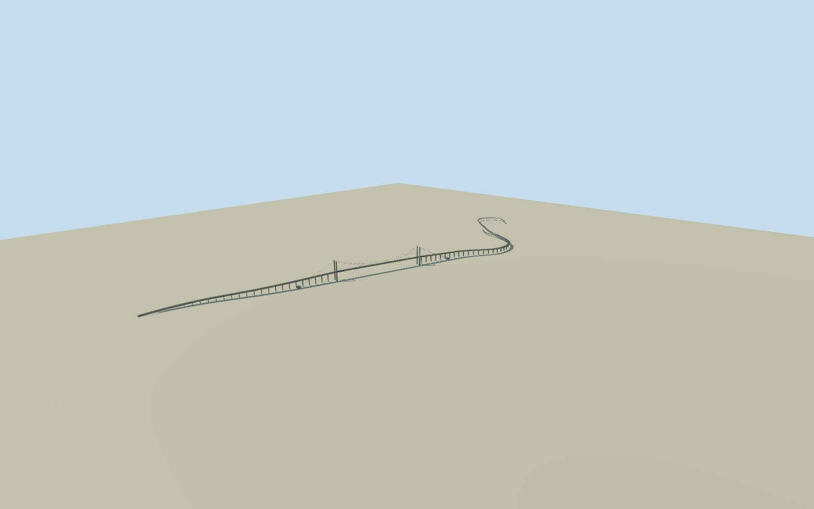

# Maputo–Katembe Bridge

Whole Maputo–Katembe suspension bridge and its intrinsic elevated approach viaducts/ramps: complete native named north/south road paths and connected elevated northern links; main suspended steel box deck, both concrete portal pylons, paired main cables/suspenders, approach concrete girders/piers, anchor blocks, barriers and four-lane road surface. All seven native elevated road records retained as plan provenance; paired carriageways resolve into the shared physical deck where coincident. Ground-level connecting highways, separate servicebridge37063620, port buildings, tollcampus, ferry terminals, natural shore/water and unrelated city structures excluded. Reconstruction uses published engineering dimensions and exact native road layout, with explicitly estimated small sections, color, supports, cable sag/hanger census and grades; no source photographs/figures used or photographic fidelity claimed.

Authoring state: **review-in-qa.json**. Current completion evidence is in [qa.json](qa.json) and the [completion ledger](../../../../qualla-structures/batches/qualla-002.PROGRESS.md).

- [Maputo–Katembe Bridge](https://qualla.com/maputo-katembe-bridge/)

Whole Maputo–Katembe suspension bridge and its intrinsic elevated approach viaducts/ramps: complete native named north/south road paths and connected elevated northern links; main suspended steel box deck, both concrete portal pylons, paired main cables/suspenders, approach concrete girders/piers, anchor blocks, barriers and four-lane road surface. All seven native elevated road records retained as plan provenance; paired carriageways resolve into the shared physical deck where coincident. Ground-level connecting highways, separate servicebridge37063620, port buildings, tollcampus, ferry terminals, natural shore/water and unrelated city structures excluded. Reconstruction uses published engineering dimensions and exact native road layout, with explicitly estimated small sections, color, supports, cable sag/hanger census and grades; no source photographs/figures used or photographic fidelity claimed.

Primary engineering dimensions:680m main span,141.2m tower height,60m navigation clearance,25.6m steel deck width and3m box depth. Primary authority describes concreteT-beam/box-girder approaches. Exact pylon leg/crossbeam shape, cable sag/diameter/hanger census, anchorblock sections, lane/railing details, colors and grades are explicit architectural/engineering estimates; no photographs or diagrams were used.

All133original native road controls/seven actual elevated ways retained as provenance. Paired carriageways become one shared physical deck where coincident, with separate elevated northern links. Native named-road centerline is about3.24km including mapped approach geometry; published3.01km main/approach engineering figure uses a different boundary. No map stretching to force a published total. No measured outer deck outline or exact pier census claimed.

Four-kilometre independent original field is unchanged, with25rawtiles and16641heights. The outermost northern ramp reaches64.44m beyond the finite review-grid edge; its grade is sampled from the same already acquired original rawtile bytes. No extension, reacquisition, masking, cutout, height fill or source refit. Wide review views can show the finite ground-fixture edge.

Piers/tower feet use the original provider ground once, with approximate vertical datum. Navigation clearance is interpreted against approximate mean-sea-level source datum; no survey accuracy or current-world automatic replacement claim. Broad natural bay, shore terrain, city buildings and ground-level connecting highways are not modeled.

Build: `node content/worldgen/source/places/ke/ker/maputo_katembe_bridge/models/generate-house.mjs`. Add `--check` to verify exact regeneration. 32440 triangles; 5 materials; no embedded photographs.
