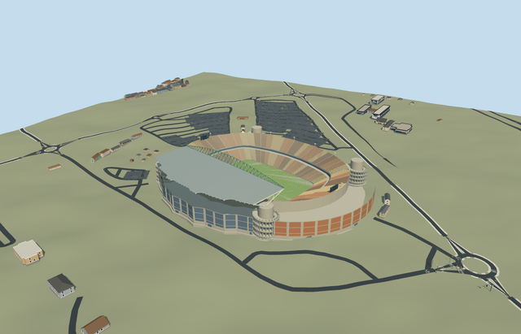

# peter_mokaba_stadium — Peter Mokaba Stadium

Reviewed 2026-10-20 in one continuous author/build/inspect/fix round.

## Appearance

Inspected48 current portable/shared/medium-fi/native-site frames during one ordinary-picture/map/build/inspect/fix pass. Native oval bowl/open field, one completed western canopy with closed pale skins/visible underside rafters/green arched girder, four rounded concrete circulation trunks and open ramp ribbons, white branches on the two western canopy cores, warm orange/sand/brown two-tier seating/radial aisles/central hospitality band, recessed service facade/closed entries, neutral football floor/markings/goals and supported end boards/light frames. Opposite side and both end stands remain uncovered. Corrected upper seating/core clearance, facade sectors across ramp bays, arch attachment, canopy/trunk height relationship and end-display supports during construction. No missing side roof is implied: proposed full-ring/other-side canopies are excluded. Portable/synthetic views expose the variable core contact planes; the native fixture proves actual terrain placement.

## Shared materials and browser levels

Five existing256-square graphs: concrete_plain, metal_painted, metal_standing_seam, window_grid and fabric_canvas. Concrete supplies structure/trunks/ramps/tiers/footings; palette-tinted paint supplies green arch/white branches/warm seats/quiet service panels/markings/neutral screens; standing-seam supplies a reusable pale roof finish; window-grid supplies closed facade/hospitality/entry glazing; canvas grain approximates turf. Five near material groups, zero embedded images/unique atlases/copied pixels. Physical shared repeats, correct linear palette tints, each nearby graph read once. Runtime POSITION/NORMAL streams are separate and counted CPU/GPU geometry bytes match; eviction releases geometry. Material finishes are medium-fi approximations rather than exact panel/glazing/perforation surveys.

| Level | Triangles | Bytes | Draws |
| --- | ---: | ---: | ---: |
| skyline | 804 | 75524 | 1 |
| district | 3642 | 334544 | 5 |
| street | 11786 | 1084968 | 5 |
| closeup | 26196 | 2390956 | 5 |

Inspected24 current medium-fi context/mode/silhouette/matched-level/transition frames: street/block/skyline, noon/late afternoon, Economy/High. All four levels retain oval bowl, single western canopy/arch, four trunk silhouettes and open opposite/end stands. District adds open ramp bands/service rhythms/neutral field details; street and closeup refine rows/aisles/roof frame/helical surfaces. Close ramps have four turns; distant levels deliberately coarsen them. Levels804/3642/11786/26196triangles, initial skyline plus district410068bytes, at most five draws. Synthetic context is not geographic evidence. Physical ordinary-laptop/phone/dense-city timings remain pending. Levels804/3642/11786/26196 triangles; at most five draws.

## Approximate map fit

Retained exact-QID OSMrelation952159 identifies the individual new stadium. Native parent52776559085407 supplies the actual whole bowl and131.210855x84.671333m opening; wider311.874x248.48m envelope is not used as pitch dimensions. Own anchor[29.468830124556625,-23.924809767142666]/heading0/native east-south; internal X[.2290394288305648,-.9734171459559199]/Z[.9734171459559199,.2290394288305648] retains the field direction. Western service-side extensions/pictures inform canopy side; detailed core/portal/row facing retains20degree/2m uncertainty. Only parent shell replaced, zero remainder/visible old shell. All67 independent resident inputs of68 originals/196 wider records, original6m standard terrain/native roads and zero-water condition remain unchanged. Bounded opening within90percent body/common supported floor removes coarse terrain intrusion without editing samples/outside ground. Each core uses its own retained terrain contact datum. Failure keeps original ground/68 buildings; all levels unload with restored ground/water and zero live model geometry. No old stadium/parking/campus slab is authored.

## Limits

Three actually viewed ordinary AFL Architects photographs on one project page establish the bowl, covered side and round ramp/branch arrangement. Page/photos are undated; later changes/current seat inventory are unverified. No qualified heights: upper seating28m, single canopy37..41.4m with nominal175m span, green arch39..52.5m, round trunk31.4m/ramp22.3m and service bands/core centers are picture-led visualization estimates. No engineering dimension, precise hidden circulation, access slope, load capacity or structural certification. Fine row/branch/rafter/portal inventory and20degree/2m facing are approximate. Raw anchor sample1290.2960175534931m defines modelY0; four core sample offsets-2.30127103435143/-3.155196191751884/+1.8165361048659179/+2.785247629113428m are coarse contact allocations, not surveyed foundations. The ground opening is not an inferred real excavation. Neutral105x68m football layout differs from rugby events in the reference pictures; temporary H-posts/crowd/sponsor text/live screens are excluded. Shared roof/window/canvas finishes are approximate. No copied pixels, furnished hospitality/service rooms, neighboring old stadium or entire parking complex reconstruction.

## Selected checks

Six Khronos files: zero errors/warnings.1292 actual mesh/material/contact checks; 48 current inspected views. Scene validation/sim30 and strict selected medium-fi audit pass. Source/runtime/LOD hashes and material bindings verified.

Rebuild: node packages/worldgen/scripts/generate-additional-landmarks.mjs --ids=peter_mokaba_stadium; node packages/worldgen/scripts/import-structure-models.mjs --ids=peter_mokaba_stadium; node packages/tooling/scripts/generate-landmark-lods.mjs --ids=peter_mokaba_stadium --force.

Source: sha256:bb977803b16fac867850503f0080f3e5c37ef594b06b5f135a9dfeb6e95c57bd

Runtime: sha256:15b7e614a6adcb9248b3fe869faccef1c2ae696324aa916f0d52bc48a9fb4186

Input: sha256:0da49fac62e0a6a3231e2b0a7226afc2d38cff0780cf40356e10c8f433996318

## Viewed ordinary pictures

https://www.afl-architects.com/projects/peter-mokaba-stadium — Hero: sunset rugby bowl and western arch canopy; AFL Architects; photographer not separately identified on page; Copyright retained by rights holder; viewed only, no pixels copied. Viewed only; no pixels copied.

https://www.afl-architects.com/projects/peter-mokaba-stadium — Peter-Mokaba_Stadium_AFL_Architects-7.jpg: concrete corner; AFL Architects; photographer not separately identified on page; Copyright retained by rights holder; viewed only, no pixels copied. Viewed only; no pixels copied.

https://www.afl-architects.com/projects/peter-mokaba-stadium — Peter Mokaba Stadium AFL Architects9: interior beneath canopy; AFL Architects; photographer not separately identified on page; Copyright retained by rights holder; viewed only, no pixels copied. Viewed only; no pixels copied.
