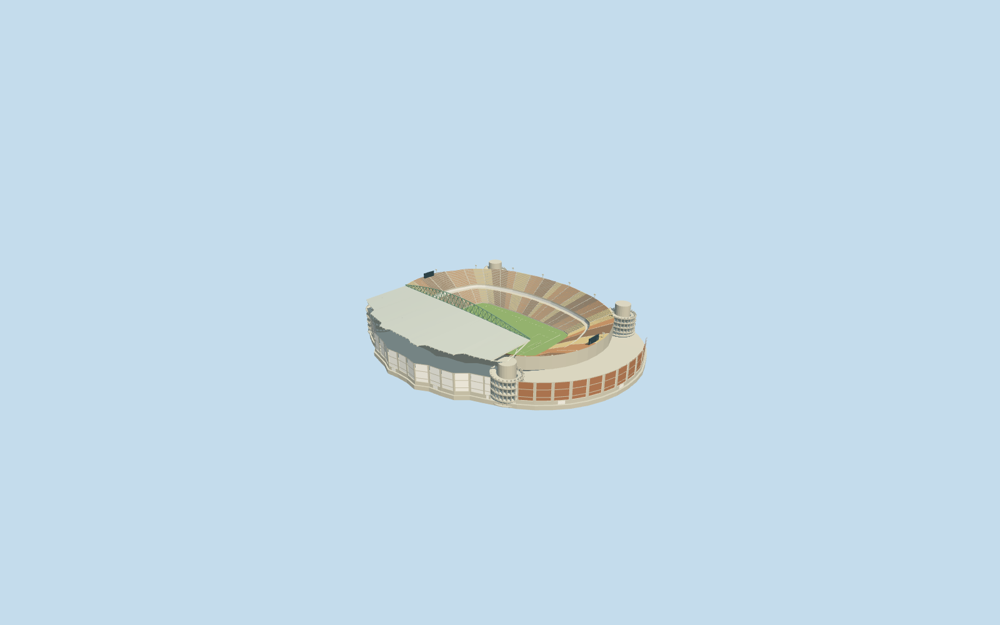

# Peter Mokaba Stadium

Specific Peter Mokaba Stadium: native oval bowl/open central floor, one completed western side canopy with closed pale skins/underside rafters and green arched girder, four rounded concrete circulation trunks/open helical ramp approximations with white branches on the two canopy-supporting western cores, warm orange/sand/brown two-tier seating set inside the corner circulation cores/radial aisles/central hospitality band, recessed concrete service facade/closed entries, neutral football field/markings/goals and independently supported end boards/light frames. Five existing shared concrete/paint/standing-seam/window-grid/canvas graphs. Opposite long stand and both ends remain uncovered. No proposed full roof, old neighboring stadium, whole sports campus/parking slab, copied crowd/event artwork or furnished service interior.

## Evidence and reconstruction

Published dimensions and reconstructed details are separated in spec.json. Primary references:

- [Reference](https://www.afl-architects.com/projects/peter-mokaba-stadium)

Specific Peter Mokaba Stadium: native oval bowl/open central floor, one completed western side canopy with closed pale skins/underside rafters and green arched girder, four rounded concrete circulation trunks/open helical ramp approximations with white branches on the two canopy-supporting western cores, warm orange/sand/brown two-tier seating set inside the corner circulation cores/radial aisles/central hospitality band, recessed concrete service facade/closed entries, neutral football field/markings/goals and independently supported end boards/light frames. Five existing shared concrete/paint/standing-seam/window-grid/canvas graphs. Opposite long stand and both ends remain uncovered. No proposed full roof, old neighboring stadium, whole sports campus/parking slab, copied crowd/event artwork or furnished service interior.

## Model and axes

26,196 triangles; 78,588 vertices; 5 material groups; 3,146,960 bytes. Native bounds: -131.010, -3.758, -152.416 to 118.750, 52.775, 152.556. Source hash: `sha256:bb977803b16fac867850503f0080f3e5c37ef594b06b5f135a9dfeb6e95c57bd`.

{"x":"east","y":"up","z":"south"}

The geographic proposal uses exact-QID OpenStreetMap evidence. Map-derived orientation and estimated architectural details require real-site visual review; preview eligibility is distinct from geographic/fidelity approval. Map attribution: © OpenStreetMap contributors, ODbL-1.0.

## Reproduce

Run `node packages/worldgen/scripts/generate-additional-landmarks.mjs --ids=peter_mokaba_stadium` (or add `--check`). The generator preserves manually edited masters by checking their baseline hashes. Import through the standard authored-model workflow with optimization disabled; then capture all QA cameras, including shared-surface views.

## Pending work

- Specific Peter Mokaba Stadium: native oval bowl/open central floor, one completed western side canopy with closed pale skins/underside rafters and green arched girder, four rounded concrete circulation trunks/open helical ramp approximations with white branches on the two canopy-supporting western cores, warm orange/sand/brown two-tier seating set inside the corner circulation cores/radial aisles/central hospitality band, recessed concrete service facade/closed entries, neutral football field/markings/goals and independently supported end boards/light frames. Five existing shared concrete/paint/standing-seam/window-grid/canvas graphs. Opposite long stand and both ends remain uncovered. No proposed full roof, old neighboring stadium, whole sports campus/parking slab, copied crowd/event artwork or furnished service interior.
- Retained exact-QID OSMrelation952159 identifies the individual stadium; standard PMTiles parent52776559085407 supplies its oval shell/central opening. Own anchor[29.468830124556625,-23.924809767142666]/heading0/native east-south, internal X[0.2290394288305648,-0.9734171459559199]/Z[0.9734171459559199,0.2290394288305648] follows the131.210855x84.671333m native opening. The whole body follows its actual irregular ring, rather than stretching the field to the wider311.874x248.48m stadium envelope. Western service-side extensions and ordinary canopy/bowl photographs fix the single-side coverage; signed frontage and fine core/row/portal positions retain20degree/2m visualization uncertainty. Independent old stadium, nearby utilities and parking remain native.
- No qualified architectural heights are retained. Working upper seating28m, single canopy37..41.4m with175m nominal span, green arch approximately39..52.5m, circular trunk31.4m/ramp22.3m and lower/service bands are picture-led visual allocations. Canopy span/width and four core centers are unmeasured reconstruction estimates inside the mapped bowl, not engineering dimensions. Ramp turns/slopes/landings/rails, detailed branch/rafter inventory and fine20degree/2m facing are approximate; no access/structural certification or concealed interior claim. AFL ordinary pictures show one completed canopy; unbuilt full-ring/other-side roof is excluded.105x68m neutral football configuration differs from the rugby events in the reference photos; temporary H-posts/crowd/sponsors are excluded. Later changes and current seat inventory are unverified.
- Standard6m Mapzen ground remains unmodified; raw anchor sample defines modelY0 and each corner core stores its own sampled native contact datum. Stadium perimeter relative range-3.3578598948392937..3.873421371810082m; core contacts/closed footings and a bounded opening within90percent of the bowl/common supported floor handle coarse terrain intrusion. The opening is not a surveyed real excavation. Original samples/outside terrain/roads/water and every unrelated building remain intact; only the owned stadium shell is replaced. Failure/unload restore original ground. No external whole-site platform, ground flattening or water cutout.

This bundle follows the medium-fi standard. Medium-fi appearance and geographic fit are reviewed separately. Hash-bound visual acceptance is recorded separately after capture inspection.
