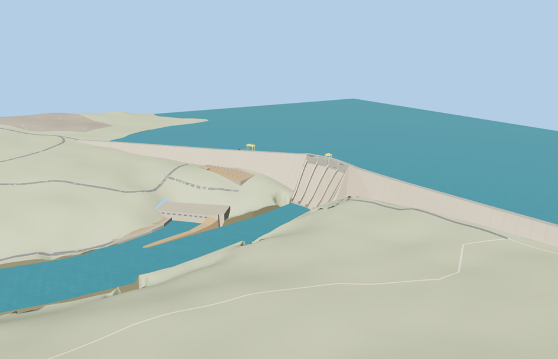

# Capanda Dam

The two angled concrete wings, four spillway chutes, curved service crossing, two yellow gantries, switchyard and powerhouse follow the signed Cuanza site. Fitted gravel banks close the apron and tailrace spur.

The viewer places the model at a fixed 956 m datum with a 961 m crest. The reservoir and downstream river use representative stages of 956 m and 875 m. Both water polygons, one neighboring building and all 11 independent road records are retained in the fixture.

The model replaces the mapped powerhouse and the two matching crest bridge fragments. A failed download restores all mapped features. Unload restores the terrain and releases model geometry. The fixed-stage water renderer extends the banks down to the terrain along mapped shores.

| Detail level | Triangles | Download bytes | Draws |
| --- | ---: | ---: | ---: |
| skyline | 727 | 63,560 | 1 |
| district | 2,451 | 222,704 | 6 |
| street | 3,155 | 282,100 | 6 |
| closeup | 4,523 | 398,524 | 6 |

The first two detail levels total 286,264 bytes. Six GLBs passed validation with zero errors or warnings. Four focused geometry checks, 30 placement probes and six shoreline traces passed. 71 renders were inspected.

Water stages, concrete elevations and equipment geometry are representative exterior estimates. The water is static and the switchyard and powerhouse interiors are outside this model.

The coarse original terrain leaves a small seam below the first spillway toe. The mapped apron and narrow tailrace bank are fitted using the retained standard terrain.

[Mapped site frame](map-frame.json) · [QA evidence](qa.json) · [Water feature settings](../../../../../../earth/hydrology/water-features.json)
