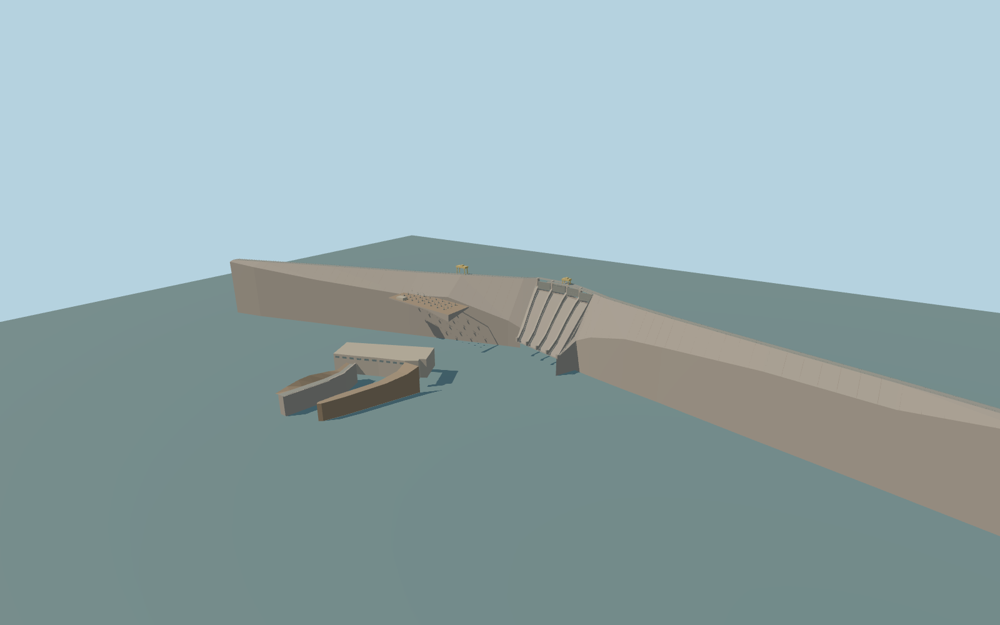

# Capanda Dam

Capanda Dam with angled concrete wings, four spillway chutes, yellow crest gantries, a switchyard, a downstream powerhouse and a fitted tailrace bank.

Rebuild: `node packages/worldgen/scripts/generate-capanda-dam.mjs`;append `--check` for exact source bytes. Select import/LOD/placement with `--ids=capanda_dam`. Detailed source and four browser tiers are separate ignored GLB outputs.

The retained shoreline gives a representative 956 m reservoir stage. The crest is modeled at 961 m, and the downstream reach uses a representative 875 m stage. The fixed model datum and water stages share the same reference.

The retained terrain has coarse banks. The modeled apron and narrow tailrace spur fit the mapped plan. Reference photographs guide the exterior equipment and fenestration.

Gate machinery, individual switchyard equipment, concrete elevations and tailrace water level are visual approximations.

The model replaces only its powerhouse and the owned crest bridge. Separate mapped service roads and buildings are retained.

Original geometry:repository license. Map:© OpenStreetMap contributors,ODbL-1.0;Protomaps. Standard terrain:terrain-grid.json. Ordinary pictures stay local and are not redistributed or used as textures. Current acceptance:qa.json.
