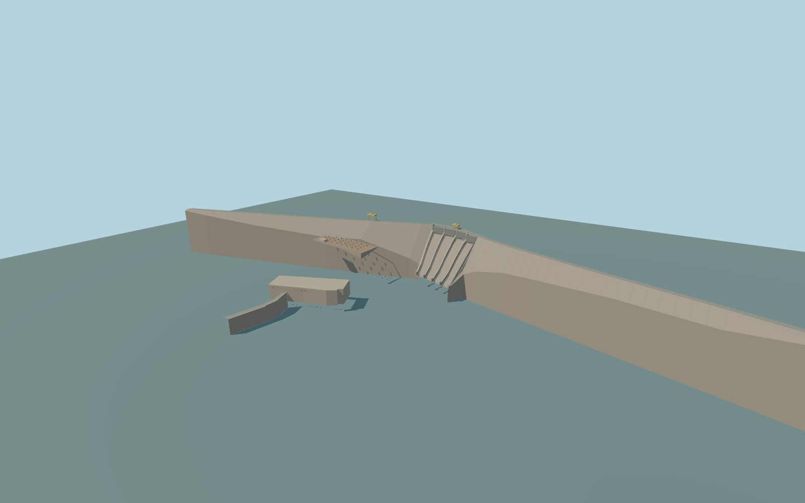

# Capanda Dam

Capanda Dam with both concrete wings, four deep spillway chutes, yellow crest machinery, switchyard, downstream generator hall and walled tailrace.

Rebuild: `node packages/worldgen/scripts/generate-capanda-dam.mjs`;append `--check` for exact source bytes. Select import/LOD/placement with `--ids=capanda_dam`. Detailed source and four browser tiers are separate ignored GLB outputs.

The shoreline median gives a 956 m reservoir model datum. The crest is modeled at 961 m and the tailrace at 875 m. Runtime positioning samples the nearby 958.33 m land shoulder. Standard inland water sampling from the retained raw field gives roughly 869–890 m for the reservoir, so geographic acceptance remains pending.

The standard raw elevation field samples well below the modeled reservoir surface. The authored terrain review places the water at its estimated shoreline level. The normal runtime water mesh currently uses the lower DEM-derived datum.

Gate machinery, individual switchyard equipment, concrete elevations and tailrace water level are visual approximations.

The model replaces only its powerhouse and the owned crest bridge. Separate mapped service roads and buildings are retained.

Original geometry:repository license. Map:© OpenStreetMap contributors,ODbL-1.0;Protomaps. Standard terrain:terrain-grid.json. Ordinary pictures stay local and are not redistributed or used as textures. Current acceptance:qa.json.
