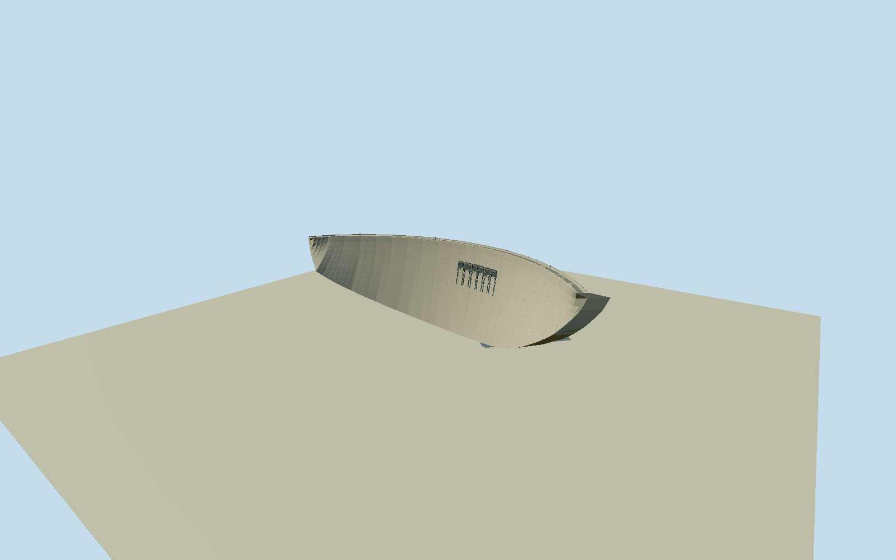

# Kariba Dam

Whole Kariba double-curvature concrete arch dam exterior, native full dam polygon and actual crest-road centerline, complete curved wall and abutments, six intrinsic sluice mouths/hoist supports, structural crestroad/parapets/railings and small intrinsic control boxes. Separate north/south underground powerstations/intakes/portals, substations, project offices/construction plant and river/reservoir/gorge/vegetation are excluded; no generic dam patch or natural terrain mesh. Use exact native crest-curve; whole convex downstream wall and tapered/doublecurved section, all6large upper sluices with intrinsic projecting hoist supports, low crestparapets and intrinsic utilityboxes. No opaque blocks over real sluice holes. Broad height128m/crestthickness13m/basethickness24m fromoperator. Native map envelope/crest length may differ from published617m; do not stretch to nominal dimensions. Hidden toe embedded in actual gorge, underside/upstreamwall shape, per-sluice fine spacing/rails and present2026refitted hoists bounded. Only cleared456x262wholeoriginal informs visible geometry, not restricted hi-res websitephotos. Freeze independent1200m field at original northern crest approach before authoring; modelY0at crest anddamnegativeY. Exclude landscape/river/reservoir and separate hydroelectric plant/substations.

Authoring state: **review-in-qa.json**. Current completion evidence is in [qa.json](qa.json) and the [completion ledger](../../../../qualla-structures/batches/qualla-002.PROGRESS.md).

- [Kariba Dam](https://qualla.com/kariba-dam/)

Exact original named dam multipolygonrelation18274317/Q1367609, two native ways1332814560/1332814559 joined at original common endpoints, all38original perimeter vertices. Native highway crestline uses original crossing nodes fromways1081170413/1332814558, including one short northern approach. Fixed+Xnorthwest towardZambia,+Znortheast/downstream,+Yup; no spline-fit/stretch of plan. Dam area is a mapped structural envelope, not a surveyed128mvertical extrusion. Use true curved/tapered wall and13mcrest/24mbase section from operator with hidden profile bounded. Bank datum at original northern crest approach chosen before independent terrain.

Whole original concrete arch-dam exterior, upper edge from original native upstream boundary, downstream toe from original native opposite boundary,13mcrest/24mbase/maximum128msection controls from operator. True horizontal and vertical curvature, six9.14x8.84mconcrete flow tunnels with closed gate leaves deep behind downstream mouths, hanging metal frames, actual native crest-road nodes, low parapets and intrinsic small cabinets. Native mapped curve is not stretched to nominal617mengineering length. Skyline simplifies the toe curve between original upstream-edge stations; higher levels retain all38native plan controls.

Exact456x262BenBird2005creator-public-domain original individually inspected/nativeSHA1matched. Qualla17families searched first:CC0portrait unrelated and excluded, uncertain Spencerconstruction pictures not used, other dam photos require attribution. Native explicitPD-user-en and original own-photo uploadlog bind Benbbb/BenBird; originalCommons transfer separately retained. No image upscaling, agency photographic controls, generated bitmap or photo textures.

Photographic low resolution does not establish fine mechanics. Gate grouping/pitch/height, broad hanging-frame forms, contraction courses/runoff, rail/cabinet census and original foundation/abutment and upstream profile are medium-fi estimates. OperatorMay2026text confirms ongoing hoist replacement; current detailed mechanisms are not certified by2005photo. The full stable concrete structure is modeled; no claim of exact present refitted machinery.

Native dam polygon is an overall structural envelope, not128mtallverticalextrusion. Upper/lower side curves are paired by native arc-distance with original vertices retained at detailed levels. Operator height/section and smoothly varying bounded exposed toe follow a plausible gorge section, not the bad DEM. Maximum wallheight128m at center, abutments shorten toward ends; buried foundation/real exposure and actual geographic ground contact remain unverified.

Independent1200m129x129field/16641samples/4rawTerrariumtiles frozen before geometry, crest reference497.7347m. Implausible negative lake returns down to-986.7526m remain untouched and are not used as water/riverbed/foundation controls. Portable/shared/context use clearly separate flat review ground below foundation. No artificial gorge/river/reservoir mesh, landscape floor or flattened sourcefield. Native placement preview/replaceFootprint=false; compatible live terrain/water/toe contact unverified.

Separate north/south underground powerstations, intake/portal structures, substations, project offices/civil construction plant and neighboring roads outside the intrinsic dam crest are excluded. Water/river/gorge/trees/people/signs/vehicles are absent. No photographed shape/style from the excluded sources is adopted.

Build: `node packages/worldgen/scripts/generate-authored-places.mjs --ids=kariba_dam`. Add `--check` to verify exact regeneration. 18878 triangles; 5 materials; no embedded photographs.
