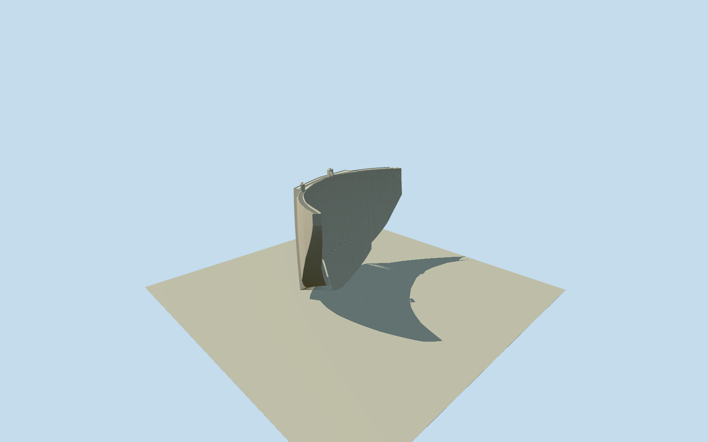

# Cahora Bassa Dam

Whole Cahora Bassa double-curvature concrete arch dam/Q12981841, actual native area-way842089986/all30 unique controls retained, complete bowed wall between both gorge abutments, crest road/edge rails and compact intrinsic crest service structures. Story171m maximum wall height/303m crest are section references; preserve actual native whole outline rather than rescale mapped controls. Hidden submerged/downslope wall taper/curvature/outlets/sections/fixtures original bounded estimates. Exclude underground hydroelectric stationway849296590/Q11962991 from aboveground body, reservoirrelation67377/Q755015, whole gorge/terrain/landscape/water/settlement/electricity network/private plant interiors. No generic straightwall or facade-only model.

Authoring state: **review-in-qa.json**. Current completion evidence is in [qa.json](qa.json) and the [completion ledger](../../../../qualla-structures/batches/qualla-002.PROGRESS.md).

- [Cahora Bassa Dam](https://qualla.com/cahora-bassa-dam/)

Actual named whole dam area-way842089986 with exact building identityQ12981841/waterwaydam/area yes, all30 unique native controls. Anchor fixed nativebbox midpoint/+Xeast/+Zsouth heading0. Separate underground generationstationway849296590/Q11962991 and reservoirQ755015 are exclusions. Published storypoint reference only. Dam area is coarse Lakewalker/Landsat mapping, not surveyed crest/wall sections; original geometry retains full native crestplan while hidden lower arch taper/elevation is bounded estimate.

Independent1000m129x129field/16641samples/2rawTerrariumtiles frozen before wall/crest/sections. Fixed SW exterior datum322.0773m; original crest+8m about330m from supplied story, maximum171m section and14m endsection. Whole native upper outline untouched, lowerarch18m downstream shift/32m addedbasewidth and smooth exposedtoe envelope original estimates; not fitted to DEM. Source lake/gorge artifacts down to-3146.5546m remain unchanged, never adopted as foundation or bathymetry. Photo only establishes upstreamcrest/serviceframes, no measuredmechanics; 2boundedgantries/8lowoutlet recesses/sections census estimated. Groundcontact and current machinery unverified; replacementfalse.

Full original native30control crestoutline retained at everyLOD, both concave/convex wall faces with verticalcurvature/basewidening/taperedend exposure, native-shaped crestroad/continuous lowconcreteparapets and twoopen servicegantries. Skyline omits estimated lowoutletmechanics; higherlevels include eight genuine deep concrete tunnels with gateleaves recessed near upstream face. Native mapped area is coarse and not stretched to story303m crestlength.

Exact existing cleared Qualla500x333 Nic2005 own-photo/explicit My photo. Placed in public domain./PD-author original/nativeSHA1matched, individually inspected. Upstream water obscureslowerwall. Hiddenwall taper, outletcount/shape/elevation and towercensus/geometry/rail/post/contractionjoint detail are bounded original mediumfi estimates, not measured present machinery. Conflictedhero and attribution/sharealike alternatives excluded withoutpixels; no image textures/generatedbitmaps or protectedplans.

Independent1000mfield/two raw tiles/16641samples frozen before geometry. Native SWdatum322.0773m, crest+8m near supplied330m. Implausible negative lake/gorge elevation down to-3146.5546m remains immutable and is never interpreted as bathymetry/foundation. Portable/context reviewground is separate below model; actual mapterrain dam/water/toe contact remains unverified, preview/replaceFootprintfalse.

Separate underground generatingstationQ11962991/nativeway849296590, reservoirQ755015, gorge/river/landscape/settlement/transmissionlines and private plant interiors excluded. No arbitrary whole-site groundplate/water mesh.

Build: `node packages/worldgen/scripts/generate-authored-places.mjs --ids=cahora_bassa_dam`. Add `--check` to verify exact regeneration. 28070 triangles; 5 materials; no embedded photographs.
