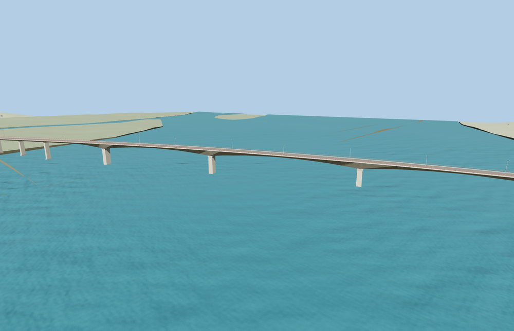

# Kassuende Bridge

Two low approach viaducts lead to the variable-depth concrete spans over the Zambezi. The shallow deck crest, red open parapets, wide shoulders, and slender lamps follow the photographed crossing. Twenty-five piers and two abutments support the deck, with open space between the piers.

The 37,240-triangle source rebuilds byte for byte. Skyline, district, street and close-up use 712, 2,608, 12,816, 24,496 triangles. Skyline and district total 297,784 bytes. Six GLBs validated and 36 current views were inspected.

Twenty-five pier probes, two abutment probes, 40 deck probes and six landing samples pass at each level. The largest landing height difference is 0.026 m. The sampled midspan clearance over mapped water is at least 16.8 m in the viewer fixture. The original highway crossing returns if the model load fails.

The authored pavement runs between the two exact mapped N7 endpoints, including short embankment transitions outside the 1,586 m concrete structure. Pier stations, box-girder depths, railing spacing and vertical grades are exterior reconstructions informed by the published overall and main span dimensions, reference photographs, and standard viewer terrain. The surrounding river and terrain use the host map and elevation data. Actual exposed pier height changes with the water level.

Rebuild with `node packages/worldgen/scripts/generate-kassuende-bridge.mjs`. Append `--check` to compare exact bytes. Use `--ids=kassuende_bridge` for targeted import, LOD, placement and readiness.
