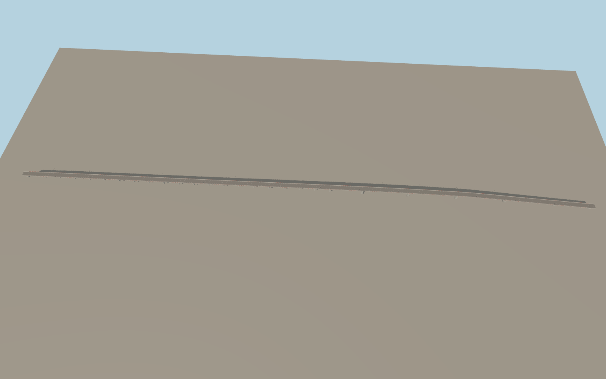

# Kassuende Bridge

Two low approach viaducts lead to the variable-depth concrete spans over the Zambezi. The shallow deck crest, red open parapets, wide shoulders, and slender lamps follow the photographed crossing. Twenty-five piers and two abutments support the deck, with open space between the piers.

Run `node packages/worldgen/scripts/generate-kassuende-bridge.mjs` to rebuild the source master. Append `--check` to compare the exact bytes. Use `--ids=kassuende_bridge` for targeted import, LOD generation and placement.

The authored pavement runs between the two exact mapped N7 endpoints, including short embankment transitions outside the 1,586 m concrete structure.

Pier stations, box-girder depths, railing spacing and vertical grades are exterior reconstructions informed by the published overall and main span dimensions, reference photographs, and standard viewer terrain.

The surrounding river and terrain use the host map and elevation data. Actual exposed pier height changes with the water level.

Original geometry follows the repository license. Map data is © OpenStreetMap contributors under ODbL-1.0 via Protomaps. Terrain samples are described in terrain-grid.json. Ordinary pictures stay local and are not redistributed or used as textures. Current acceptance is recorded in qa.json.
