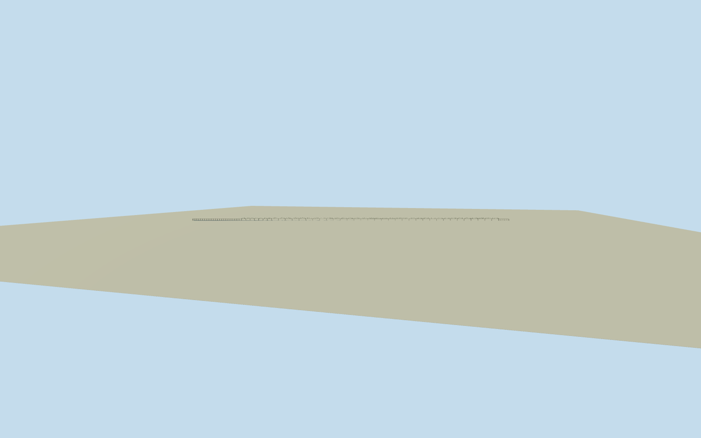

# Dona Ana Bridge

Whole surviving DonaAna railwaybridge/Q1239603 acrossZambezi: full native named mainway32776288 and connected SWapproach410111566/NEapproach410111569, allnative ends/bends retained, approximately3674m total including2997m mainstructuralcrossing/564mSW/114mNE approaches. Complete40 paired steel throughtruss spans (33x80m and7x50m nominal fromQuallastory), polygonal upperchords/endposts/open vertical-diagonal webs/toplateralbracing, railwaydeck/crossbearers/concretepiers/abutments, intrinsic1067mmgauge track/simplepedestrianlane/rails and full bounded approachviaducts. Main spanordering/sections/pierstations/approachrepeat/hidden details originalestimates inside nativeends. Exclude temporarycrane/one collapsed2000span slope inreference, river/water/landscape/neighborhood/roadbridgeN322/otherrailway/privateinteriors. Existing parallel footpath570690312 co-located on same bridge, not a separate secondbridge.

Authoring state: **review-in-qa.json**. Current completion evidence is in [qa.json](qa.json) and the [completion ledger](../../../../qualla-structures/batches/qualla-002.PROGRESS.md).

- [Dona Ana Bridge](https://qualla.com/dona-ana-bridge/)

Whole actual native mainrailbridge32776288/Q1239603 and connected564mSW410111566/114mNE410111569 approaches, allnativeends/bends retained,3674m fullphysicalextent. Complete40pairedpolygonalsteelthroughtrusses inside2997m mainends, deck/concretepiers/abutments/current1067mmrail/noelectrification/intrinsicfootway. Co-located path570690312 samebridge, no secondfootbridge. No neighboringroadbridge/landscape/river/sitepad/privateinteriors.

Qualla-first11families/0conflicts. One exact886x570USAID officialgovernmentwork2000 original/nativeSHA1matched/PD-USGov-USAID and reviewedofficialFlickrUnitedStatesGovernmentWork, personallyinspected/existingunchangedpolicy passed. TransferredPD-author source unpinned/skippedwithoutpixels, othernativecategoryOGL/CCBY/CCBYSA unused. Sourceflooddamage/deckcollapse/crane excluded from current wholebridge; reference controls structuralfamily, later finish/repairs hidden estimates. No supplementalpixels/borrowedmesh/phototexture/generatedbitmap/imagerypolicy changes.

After independentground frozen: deck+8m/pierbottom-14m/shaft3.4x7.8,33nominal80m+7nominal50m mainspans with6.536m totalnativeendoffset. Seven50mspans groupedSW as originalestimatedordering, not measuredpierstations. Polygonalupperchord11.4m/short8.2/frame4.5m/mainrailbed5.7m/.72mdeck, intrinsic1.15mfootwaycenter+3.35/1067mmgauge. Approach24mbeam-pierpitch/hiddenconnections/currentpaint/census estimated. Sleepers/footrailposts sampled by detailbudget; full40truss stations retained, skyline centralopen trussribbon and pierprofiles, district pairedopenframes, nearfullsolidmembers/topbracing/rails.

Independent4000m129x12916641-value field/20rawtiles/PNG frozen before all deck/pier/geometry unchanged, fixedexteriordatum49m. Publicsource river/urbanrelief not bathymetry or railwayfoundation survey; exact source/host footing/deck/riverbankcontact unresolved/replacementfalse. Appearanceflatstage separate; no terrainfitting/flattening/reacquisition or whole-sitepad.

Build: `node packages/worldgen/scripts/generate-authored-places.mjs --ids=dona_ana_bridge`. Add `--check` to verify exact regeneration. 51792 triangles; 4 materials; no embedded photographs.
