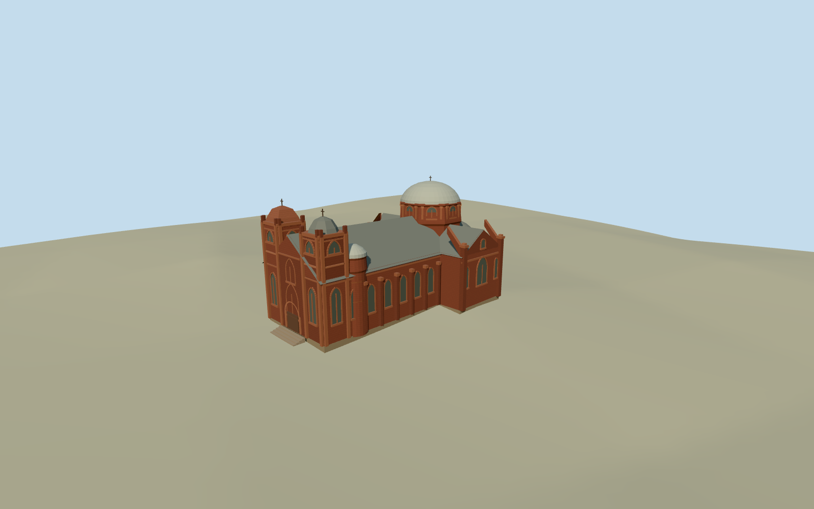

# St Michael and All Angels Church, Blantyre

The 1891 red-brick church in Blantyre with its unequal west towers, octagonal dome and rounded apse.

Authoring state: **review-in-qa.json**. Current completion evidence is in [qa.json](qa.json) and the [completion ledger](../../../../qualla-structures/batches/qualla-004.PROGRESS.md).

- [St Michael and All Angels Church, Blantyre](https://qualla.com/st-michael-and-all-angels-church-blantyre/)

Draft exterior: approximate photographic proportions and simplified ornament. It is not a survey, photogrammetric reconstruction or approved current geographic replacement.

The two original publications show the west face and opposite three-quarter angle. Recorded aisle, crest, choir and apse dimensions set roof and stonework scale.

Terrain sampling/contact, geographic alignment and site activation remain pending. Runtime LODs are produced by the registered after-import pipeline and require visual review.

Reference photos remain in the local Qualla corpus; only provenance, paths and hashes are retained here.

Build: `node content/worldgen/source/places/kv/kv0/st_michael_and_all_angels_church_blantyre/models/generate-st-michael-and-all-angels-church-blantyre.mjs`. Add `--check` to verify exact regeneration. 8561 triangles; 6 materials; no embedded photographs.
