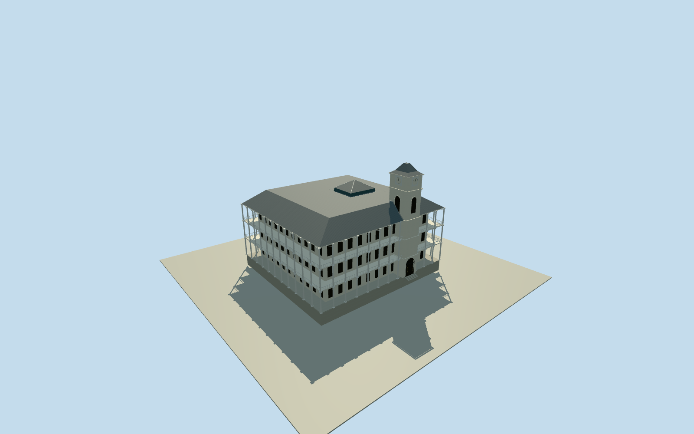

# House of Wonders, Zanzibar (2010)

Complete House of Wonders in its intact October2010 museum phase: whole roughly50m quadrilateral palace, all four deep external verandas on three high storeys, iron columns/brackets/open gallery railings, original high timber entry and approach steps, complete main metal roof, central raised rooflight and projecting clocktower including roof. Intrinsic covered atrium and galleries retain their architectural void; no neighboring palace/fort/gardens/cannons/trees/vehicles/exhibits. Full mapped whole outline and all three intrinsic roof/tower parts retained. Precise rear bay census, clocktower vertical bands, roof junctions and historic grade are bounded architectural estimates from complete native parts, clear partial front/interior/detail originals and primary dimensional text; not a measured restoration survey. No claim of current post2020 survival.

Authoring state: **review-in-qa.json**. Current completion evidence is in [qa.json](qa.json) and the [completion ledger](../../../../qualla-structures/batches/qualla-002.PROGRESS.md).

- [House of Wonders](https://qualla.com/house-of-wonders/)

Front2004originaltreeoccluded/croppedaboveclocktower; precisehiddenupper/rearbands/roofjunctions are boundednative-part/text/photo estimates, not claimed directphotographicmeasurements.

No currentpost2020restoration/scaffold state adopted. Completeintrinsicpalace scope retained; historicdatevalidity is explicit.

Independentfield/frame/datum mustbe frozenbeforefloor/mainsection choices andgeometry. Hiddenarchitecture/grade neednoexactsurveygate; preserve originalfield onceacquired.

Fullnativeouterquad and threeintrinsicparts retained. Verandacoreinset5.5mradial/columnbaycounts/rearfenestration/roofjunctions/clocktowerverticalbands/overall39mheight andatrium11.2x9.6m are architectural estimates; no precisephotographicorrestorationsurveyclaim.

Primaryconservationtext measuredstoreyheights7/6.8/6.5m retained; laterpreprintunreviewed. Currentnativelevelnumbersdescribe approximatecomponentclass only, not exact2010metricfloorheight.

Exactmonth2010-10 represented15th convention. No currentpost2020intactplacement; narrowhistoricalmonthvalidity.

Originalcurrentfieldcancontainurbanheightbias anddoesnotmeasure2010ground. Preserveoriginalfield/floor/frames; record grade/contactlimits instead of liftingbuildingorcarvingbroadpad.

Clock dial hand positions are illustrative, not a recovered historical time. Individual carved fanlight figures, inscriptions and exact door filigree are simplified architectural ornament; no source photographs or artwork textures copied.

Portable isolated stage lies below the palace foundations; terrain-contact certification is not implied. Original current urban elevation can conceal portions of the 2010 ground storey.

Build: `node content/worldgen/source/places/ky/kyg/house_of_wonders/models/generate-palace.mjs`. Add `--check` to verify exact regeneration. 29273 triangles; 6 materials; no embedded photographs.
