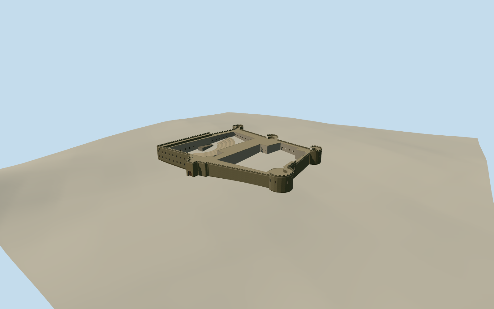

# Old Fort of Zanzibar

Ngome Kongwe, the coral-stone waterfront fort of Stone Town, with rounded bastions, stepped battlements, two open courts and the open-air theatre.

Authoring state: **review-in-qa.json**. Current completion evidence is in [qa.json](qa.json) and the [completion ledger](../../../../qualla-structures/batches/qualla-003.PROGRESS.md).

- [Old Fort of Zanzibar](https://qualla.com/old-fort-of-zanzibar/)

The model depicts the standing fort in July 2004, including the two open courts and the documented open-air theatre.

The native outer and inner rings constrain the masonry envelope and courtyards. The original photograph informs the waterfront wall color, cornice, two tiers of openings and rounded crenellations. Unseen elevations, the roof walks and theatre seating profiles are reconstructed estimates.

Original terrain is preserved. The inland field rises toward the rear towers and may include roof or canopy elevations. Wall contact and historical terrace levels are approximate.

Build: `node content/worldgen/source/places/ky/kyg/old_fort_of_zanzibar/models/generate-zanzibar-old-fort.mjs`. Add `--check` to verify exact regeneration. 9706 triangles; 5 materials; no embedded photographs.
