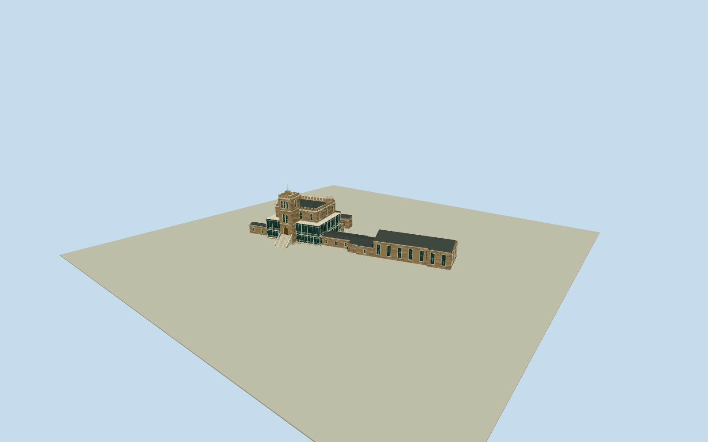

# Larnach Castle

Whole current Larnach Castle: native46-control mainhouse/attached long ballroom/connector/rearwings plus shared-node six-control north extension. Warm rubble masonry/lighttrim, projecting crenellated Gothic tower/stairturret/arched entrance/steps/triplewindows, enclosed two-storey white-ironwork verandas on three sides, chimney groups/slate roofs. Exact published creator-own PD-self Qualla original first/only. Full native scope retained; uppersections/profiles/fineornament/window-chimneycensus/hiddenjoins/north-extensionuse/currentfinish/groundcontact original bounded estimates. Geographic preview/replacementfalse; no copied sourcepixels, garden/fountain/lodge/stables.

Authoring state: **review-in-qa.json**. Current completion evidence is in [qa.json](qa.json) and the [completion ledger](../../../../qualla-structures/batches/qualla-002.PROGRESS.md).

- [Larnach Castle](https://qualla.com/larnach-castle/)

Whole46-control castle/ballroom perimeter plus connected six-control north layer1 extension, fixed union-native-bbox anchor/heading0 before independent field, floor, sections or geometry. Native twolevels is unverified, not a surveyed height.

Whole native46-control castle including long ballroom/connector/rear projections, plus actual shared-node six-control north layer1 extension. Internal axes derived only from actual front edge0-to1, no geographic reframe. Front facade faces negative internalU. Main masonry core/tower/veranda subdivisions are original photo/native-outline inferences, not native separate part polygons. Ballroom Cafe point lies in long southern wing, not separate neighboring detached small building990591535. Connected north layer1 extension is retained as low enclosure/canopy with unverified exact use/height. Stables/lodge/storage/greenhouses/detachedbuildings/gardens/fountain excluded.

Original independent256m129x12916641-sample/two raw tiles/native union-bbox anchor/heading0/SW288.0381m provider-relative datum frozen before all floor/sections/geometry. Once-only original field at western tower exterior fixes floor11.8058m. Original photo-bounded sections: veranda3.9/8.8m, corecornice13.6/parapet14.8, tower19.5/20.8/stairturret21.4/flagpole25.5, ballroom6.4/9.1, connector3.5/4.2, rearwings4/5.5, northsharednodeextension3.8/4.4. Heights/profile/fineornament/chimney-windowcensus/hiddenjoins/currentfinish/extensionuse/exactgroundcontact unsurveyed original estimates. Whole46+6 nativeXZ controls retained. Primaryheritage text supports tower/three-sided two-storey verandas/attached ballroom/materials; 1966interiorballroom90x30ft only approximate factualcontext, not an exterior roof survey. No later sourcefield/floor/anchor changes/fitting/flattening/reacquisition/reframing/raising.

One exact published2013 Pseudopanax own/PD-self original, individually viewed/nativeSHA1matched and unchanged published guard passed. Other entrance/unrelated Dunedin sources unselected; no supplemental or rights repair/reclassification/bypass. Primary heritage/government architectural facts only; no protected additional imagery/plans or source pixels. Fine sculpture/lion artwork deliberately simplified/omitted, no interiors.

Original independent256m129x12916641sample/two raw tile field/fixed union-bbox anchor/heading0/SW288.0381m providerdatum frozen before floor11.8058m/sections/geometry. No fitting/flattening/reacquisition/reframing/late floor or modelraise. Precise hillside threshold/foundation/basement contact unverified; preview/replacementfalse. Portableflatground/contexthouses are fixtures.

Build: `node content/worldgen/source/places/pz/pzc/larnach_castle/models/generate-larnach-castle.mjs`. Add `--check` to verify exact regeneration. 40743 triangles; 5 materials; no embedded photographs.
