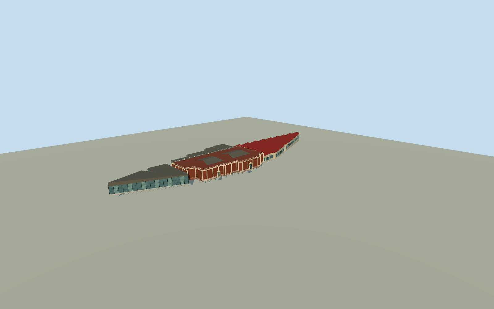

# Toitū Otago Settlers Museum

Toitū Otago Settlers Museum with the historic Edwardian Burnside facade, Deco road-service depot with red sawtooth clerestories, and pointed floor-to-ceiling glazed Josephine Foyer.

Authoring state: **review-in-qa.json**. Current completion evidence is in [qa.json](qa.json) and the [completion ledger](../../../../qualla-structures/batches/qualla-003.PROGRESS.md).

- [Toitu Otago Settlers Museum](https://qualla.com/toitu-otago-settlers-museum/)

Joined exterior; component joins and precise height distribution are approximate. The original Burnside façade uses its dated postcard, and the modern entry uses the Qualla CC0 foyer image and written design account.

The three main faces, corner curvature, depot saw-toothed roof and glazing capture the published architectural distinctions. Recent signage, art, fixtures and display interiors are outside the model scope.

The separately mapped railway station stays independent. Grading is approximate based on the public composite terrain field.

Build: `node content/worldgen/source/places/pz/pzc/toitu_otago_settlers_museum/models/generate-toitu-otago-settlers-museum.mjs`. Add `--check` to verify exact regeneration. 6918 triangles; 6 materials; no embedded photographs.
