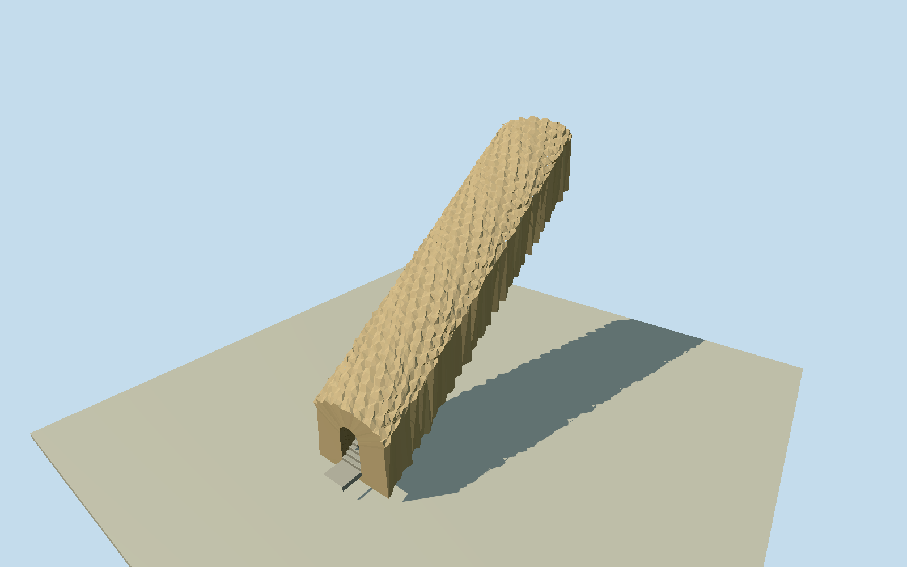

# Tunnel Beach stair tunnel

Human-carved Tunnel Beach stair tunnel: full mapped straight passage, both rough sandstone portals/barrel-vault rock enclosure, concrete stair run and small immediate exposed rock/entrance cuts. Natural sea arch/headland/sea stacks/coast/beach/waves, whole coastal walk/fences/signs and vegetation excluded; mapped external36/7-step paths are separate from interior tunnel.

Authoring state: **review-in-qa.json**. Current completion evidence is in [qa.json](qa.json) and the [completion ledger](../../../../qualla-structures/batches/qualla-002.PROGRESS.md).

- [Tunnel Beach](https://qualla.com/tunnel-beach/)

Native way107479913 is explicitly tunnel=yes/layer-1/steps=yes/surfaceconcrete, with exact two endpoints giving15.297686899852067m horizontal length and bearing-0.6028143406650925rad; +Z follows north-eastern endpoint southwest to other portal. It is a true mapped centreline, not a measured rock-wall polygon; corridor width/height and rock-envelope controls remain photograph-based estimates. Separate external approach paths carry36 and7 step counts and cannot establish interior riser count. Published Qualla narrative says72 interior concrete steps; operator confirms historic stepped rock tunnel but does not enumerate risers. Before authoring, use source terrain/photographs to determine descent sign and record floor/portal heights independently of original field.

Original16641value independent source field and both raw tiles/PNG frozen before geometry. Fixed northeastern exterior point datum15.1657m; coarse surface near two endpoints differs only0.58m and cannot establish underground floor/stair grade. Native path/Qualla72-step narrative and published long ascending tunnel views establish a straight steep staircase. Northeastern upper entrance floor+0.03m and southwestern lower floor-10.77m (72estimated0.15m risers) chosen before geometry; floor/portal elevations, widths/vault and direction relative to coarse field remain architectural estimates, not a survey. Do not fit/flatten/reacquire source field. Isolated enclosure is a bounded rock section of the human tunnel, intended to embed in compatible host rock; no whole headland, natural sea arch or unmodified coarse-terrain contact claim. Replacementfalse.

The human-carved full mapped stair passage and both portals are modeled. The independent natural sea arch/headland/sea stacks/whole coastline/beach/waves/long approach path/fences/vegetation are not this structure. Surrounding rock is a bounded truncated cut section for standalone inspection and compatible embedding, not a claimed freestanding stone tube or reconstruction of the whole cliff.

Original cleared Qualla references individually inspected: Ingolfson native public-domain montage/overview and Pseudopanax2023 ownPD-self tunnel/rock context. Exact originals whose local categories omit the native release are copied unchanged and independently bound using existing creator-release verification; no article/media repair or questionable source. Context-only natural-arch images are not substituted for the human tunnel.

Exact native horizontal centreline length15.2976869m/bearing controls the route. Interior72-riser census comes from the published Qualla story; operator confirms a short stepped dark rock tunnel but not the count. Estimated0.15m riser/1.25m clear width/2.15m vault/portal elevations and rock-cover thickness are not surveyed. Nearby mapped36/7-step paths are separate and excluded.

Rock enclosure has real continuous interior void/rough barrel vault/open portals, concrete stair run and short thresholds. Medium-fi chisel facets/damp stone tones/worn concrete nosings are original deterministic geometry/vertex color with three actual shared canonical slots/two shared graphs; no photographic textures, borrowed mesh, artificial lights/handrail, physics or water effects.

Four detail levels retain the same open full passage and both portals. Every detail level retains all72 story-sourced risers. Near levels add fine faceting/worn nosings/tool scars without filling the void. Independent source terrain/PNG/two tiles remain unchanged; its unresolved underground grade is separate evidence, isolated/flat context views do not certify host contact and geographic replacement stays disabled.

Build: `node packages/worldgen/scripts/generate-authored-places.mjs --ids=tunnel_beach`. Add `--check` to verify exact regeneration. 13508 triangles; 3 materials; no embedded photographs.
