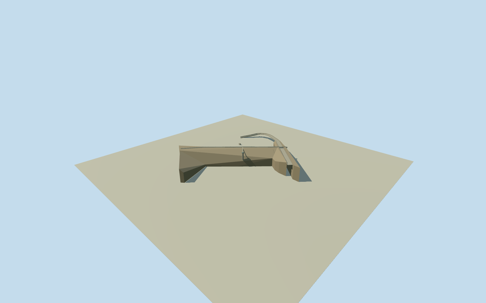

# Serpentine Main Dam — Western Australia

Whole Serpentine Main Dam, Western Australia, as an approximate2007historical reconstruction: complete rolled-earth embankment and original23control physical dam boundary, whole five-control crest road/spillway bridge, full ten-control enlarged spillway canal, intrinsic offtake/control tower/access link and buried conduit. Government water-protection plan gives55m height and424m crest; heritage record identifies earthfill/spillway/control tower and explicitly records removal of the old curved concrete observation wall/platform/tainter gates in2001/2002. Those demolished elements are not reconstructed for2007;2022proposed crest raising is not treated as proof of completed current geometry. Native actual lengths preserved rather than stretched to rounded published dimensions. Exact ring/road/canal/conduit horizontal controls retained; vertical role of boundary, bank/foundation/road/channel sections, intake/control-tower registration/form, access bridge, roofs/fittings/finish/grade are estimates. Separate Pipehead Dam, detached cafe/tearoom, garden/fountain/playground and reservoir/park/interiors excluded as independent structures. No imagery used or photographic fidelity claimed.

Authoring state: **review-in-qa.json**. Current completion evidence is in [qa.json](qa.json) and the [completion ledger](../../../../qualla-structures/batches/qualla-002.PROGRESS.md).

- [Serpentine Dam](https://qualla.com/serpentine-dam-western-australia/)

Whole Serpentine Main Dam, Western Australia, as an approximate2007historical reconstruction: complete rolled-earth embankment and original23control physical dam boundary, whole five-control crest road/spillway bridge, full ten-control enlarged spillway canal, intrinsic offtake/control tower/access link and buried conduit. Government water-protection plan gives55m height and424m crest; heritage record identifies earthfill/spillway/control tower and explicitly records removal of the old curved concrete observation wall/platform/tainter gates in2001/2002. Those demolished elements are not reconstructed for2007;2022proposed crest raising is not treated as proof of completed current geometry. Native actual lengths preserved rather than stretched to rounded published dimensions. Exact ring/road/canal/conduit horizontal controls retained; vertical role of boundary, bank/foundation/road/channel sections, intake/control-tower registration/form, access bridge, roofs/fittings/finish/grade are estimates. Separate Pipehead Dam, detached cafe/tearoom, garden/fountain/playground and reservoir/park/interiors excluded as independent structures. No imagery used or photographic fidelity claimed.

Government2007 water-protection plan specifies completed1961,55m high,424m crest. Native complete crossing measures 416.5785389829156m and remains unchanged rather than stretched. Heritage construction record specifies rolled earth dam, spillway and control tower; curved observation wall/platform/tainter gates demolished2001/2002 and spillway enlarged. Those removed structures are excluded.2022crest-raising proposal is not evidence of a completed present appearance.

Approximate220m absolute crest/provider registration is an explicit visualization estimate, not a surveyedAHD level.55m maximum exposed section fixes estimated valley floor; abutment taper,8m crown,18m spillway throat widening/channel sections and estimated channel levels are not engineering measurements. Original23control body boundary does not certify a toe or floor; estimated channel cut through embankment is geometry of the structure, with original source terrain unchanged.

Heritage text verifies a control tower but not its detailed geometry. Its registration at the upstream buried-conduit endpoint, cylindrical6.4m body, square6m control cabin, shallow hipped roof,25m shaft, access bridge and exterior fittings are bounded reconstruction estimates, not surveyed source outlines or photograph-based claims. Conduit exterior outlet position follows both native endpoints; buried interior and hydraulics are excluded.

Whole main dam/crest/spillway bridge/full enlarged canal and intrinsic control/tower/conduit assembly included. Independent Pipehead Dam, detached cafe/tearoom and visitor buildings, garden/fountain/playground/park/reservoir and interiors excluded. Earth/stone/concrete/paint finish, service rails/stairs and grade are estimates. No source image/plan/figure pixels or diagrams used.

Original1024m/16641height field and four raw tiles acquired before floors/main sections, preserved unmodified. Severe original DEM low void reaches-8270.5312m absolute, datum206.3152m; coarse grade can obscure sections. No mask/flatten/cutout/reacquisition/refit during visual review. Ground contact/vertical registration unverified; approximate2007 historical reconstruction only, current-world replacement ineligible.

Build: `node content/worldgen/source/places/qd/qd4/serpentine_dam_western_australia/models/generate-house.mjs`. Add `--check` to verify exact regeneration. 3250 triangles; 5 materials; no embedded photographs.
