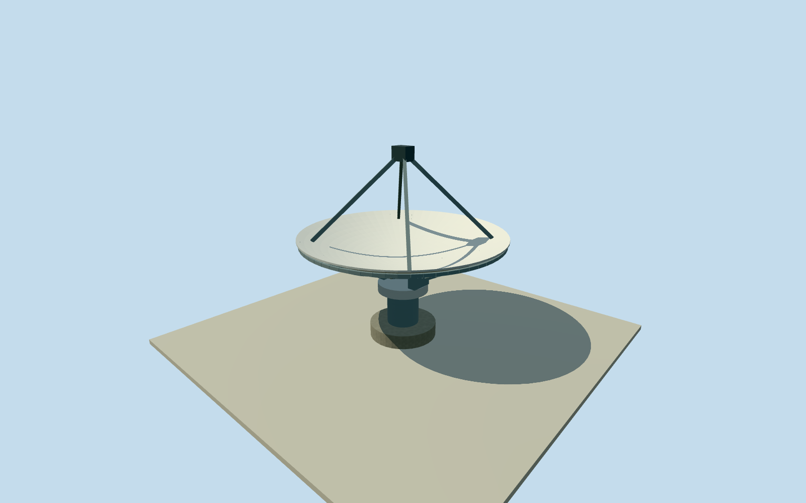

# ASKAP 12-metre radio antenna

Whole 12 m prime-focus paraboloid, both reflector faces and rim, quadrupod/receiver, rear ribs, three-axis support envelope, pedestal and concrete base. Written mechanical facts and numerical native antenna positions only. Reusable equipment with 36 individual geographic placements; whole observatory remains in progress.

Authoring state: **review-in-qa.json**. Current completion evidence is in [qa.json](qa.json) and the [completion ledger](../../../../qualla-structures/batches/qualla-002.PROGRESS.md).

- [Murchison Radio-astronomy Observatory](https://qualla.com/murchison-radio-astronomy-observatory/)

Whole ASKAP12mantennahardware—reflector/bothfaces/rim/quadrupod/primefocusfeed/rearstructure/mount/pedestal/base. Nativeoriginalreferencepoint/12mdiameterfixedbeforefield. Reusableequipmentgeometryanddistinct36actualpointplacements, neveronesingledishaswholeobservatory. Allimageryunused; exactheights/mechanicaldetails/pose/finish estimates remain.

Operator12mdiameter/focalratio.5 fixes6mfocaldistance and1.5mdeep paraboloid at6mradius. Entirefront/backreflector, continuousrim, quadrantfeedlegs/PAFbox, rearframe, elevationyoke/azimuthbearing/pedestal/concretebase included. Nominalvertex4.6maboveprovider-relativeorigin/primefocus10.6m, shell.1m/feedpackage1.0x.75x.8m, support/pedestal/base sizes andribcounts are explicit estimates,1.5mheight/1mcomponentuncertainty. Not a flatdisc/radome/oneportal proxy.

OriginalactualBiyarlinode2377898985 andderived12mdiametercircle fixed before independent256m129x129field/16641values/4rawtiles; datum375.7684m/range371.6255..377.9829m. Floor.2m/base-.4m/vertex4.6m/focus10.6m selectedonce afterfield. Originalfield/frame/floors/mainsections nevercut/masked/flattened/refetched/reframed/refit forcaptures. Source2026numericdata approximates2013phase; oldguide/softwareelevations not adoptedasground. No surveyedcontact/verticalregistration.

Illustrativezenithstowpose only; actualthree-axisorientationvariesduringobservation. Mainparaboloid/quadrupod form fromwrittenmechanicalfacts; exact mount/counterweight/backstiffener/PAF2013casing/finish/cabling not established, original estimates retained. No specificobservingtarget/workingRFIorpointingperformance claimed. Laterreceiverinternals and hiddenelectronics excluded.

One reusable12mequipmentmodel, withall36originalnamed/refASKAPpoints asdistinctgeographicinstances. Eachnativeposition/identity/footprintbound preserved; no compositeGLB/centroidplacement, fake36thpoint or ASKAP34-asEDGESsubstitution. Derived32pointcircle isreportedreflectordiameterenvelope, not a mappedfoundationpolygon. Instancepositions verifiedbeforecompletion.

Qualla first4families/1conflict, everyimageunused. OriginalauthorPDFread forwrittenfacts only; allphotos/plans/diagrams/figuresunused. OriginalnumericOSMnodes/12mdiametertags retainedwithODbLcredit. No rightsrepair/questionableimagery orimageapproval claimed.

Approximate2013datedproposal/currentWorldEligible false. Entireequipment/aperture/support/base retained atfourLODs; curvature/shellsegments/rear-rib/pedestal-sides reduce atdistance. Parentobservatory remainsunfinished untilMWA128/2013EDGES/requiredsupportcoverage complete.

Build: `node content/worldgen/source/places/qe/qe6/askap_radio_antenna/models/generate-house.mjs`. Add `--check` to verify exact regeneration. 8084 triangles; 5 materials; no embedded photographs.
