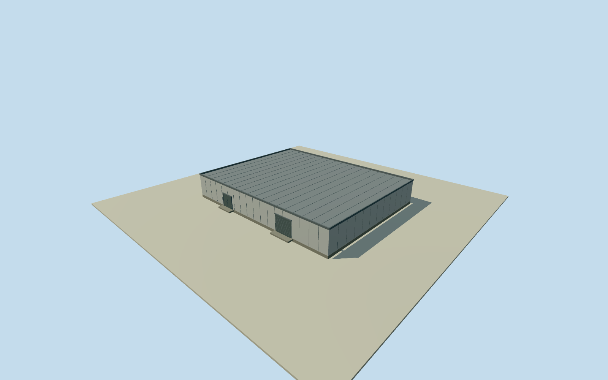

# Murchison Radio-astronomy Observatory control building

Whole independentMROcontrolbuilding, completeactualnativefourcornerplan/allwalls/fullflatmetalroof/parapet/base/closedexteriorsteelairlockentry/workshopdoor/twoestimatedintrinsicchillercabinets. Primarywrittenfacts and numericalfootprint only; everyimageunused. Roof/height/sections/facade/doors/finish/plantcensus estimates explicit. Separategeographicasset, not a completionproxy forwholeobservatory.

Authoring state: **review-in-qa.json**. Current completion evidence is in [qa.json](qa.json) and the [completion ledger](../../../../qualla-structures/batches/qualla-002.PROGRESS.md).

- [Murchison Radio-astronomy Observatory](https://qualla.com/murchison-radio-astronomy-observatory/)

Whole independent MROcontrolbuilding. Partofcomplete2013MROcollection; cannot completeparentalone. Originalfullfootprint retained; heights/floors/roof/airlock/chillers/workshopfinish estimated afterfield. Allimageryunused.

Actualoriginalfullfourcornerenvelope about35.52x27.76m; allfourwalls/complete roof/base/closedairlock/mainserviceentrances represented. Originalnative2026map onlyapproximates2013registration. One-storey externalform, lowflatroof/parapet,steelpanelcladding/cornertrim, doorcount/baycensus, service/chillerboxes andposition/color/finish are estimates,2mplan/height uncertainty. Exactinterior dualshielding/RFIperformance not modelled or claimed.

Original independent256m129x129field,16641values/2rawtiles,datum374.048m/range368.671..375.3636m frozen before floors/mainsections/geometry. Floor.2m/base-.5m/roof4.8m/parapet5.15m fixedonce afterfield. Originalfield/frame/floor/mainsections nevercut/masked/flattened/refetched/reframed/refit forcaptures. Coarsecomposite groundmaybury/exposebase/doors; no surveyedcontact or verticalregistration.

Writtenprimaryfacts establish controlbuildingfunctions/pairedsteelairlockdoors/workshopandchillers; hiddenconstruction/ceiling/roofprofile/externaldetails not surveyed. Closedexteriordoors, approximatewallpanels,2rearservicecabinets andintrinsicflatsteps only. Exactsiteborefield/cables/unseenrooms excluded. This whole independentcontrolbuilding cannotstandforwholeobservatory.

Qualla first4families/1metadata conflict; allimageryunused. Originalauthor/operatorPDFs directlyretrieved andread forwrittenfacts only, no sourcephotos/figures/plans/diagrams. OriginalOSMnumericfullfourcornerfootprintretained withODbLcredit. No rightsrepair/photo-derivedgeometry or imageryapproval claimed.

Approximate2013datedproposal/currentWorldEligible false, individualcontrolbuilding asset/actualgeographicplacement. ParentMROcollection remainsunfinished untilall declaredrequiredantennas/tiles/EDGES/supportbuildings complete; no compositeGLB orcentroidplacement. AllfourLODs retainwholebody/roof/closedentrances; finetrim/panelgrooves/servicegrilles reduce atdistance.

Build: `node content/worldgen/source/places/qe/qe6/murchison_control_building/models/generate-house.mjs`. Add `--check` to verify exact regeneration. 1562 triangles; 6 materials; no embedded photographs.
