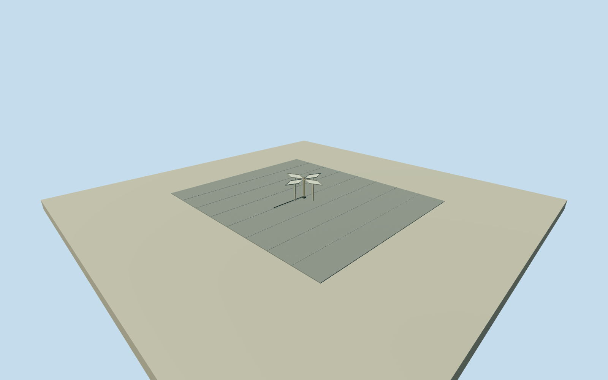

# Murchison EDGES fourpoint antenna

Entire November2013fourpoint instrument, allfour horizontal diamond panels/rims/centralbalun/topcap/estimated support and capacitor details, underlying receiver and full5.8x5m conducting groundplane. Original written dimensions/facing, no imagery. Groundplane sheet construction, small parts and30m geographic registration explicitly approximate.

Authoring state: **review-in-qa.json**. Current completion evidence is in [qa.json](qa.json) and the [completion ledger](../../../../qualla-structures/batches/qualla-002.PROGRESS.md).

- [Murchison Radio-astronomy Observatory](https://qualla.com/murchison-radio-astronomy-observatory/)

Whole November2013 EDGES fourpoint instrument, allfour horizontal diamond panels/vertical rims/centralbalun/topcap/inter-panel capacitor indications/estimated supports/receiver housing and full5.8x5m groundplane. Primary2013numerical dimensions and written form only; every image unused. Geographic registration is approximate30m: nearby mapped hut618004254 provides context, assumed20m south7degrees west of it, not a surveyed historical antenna point or proven hut identity. No ASKAP34dish or later2015blade/plus-groundplane substitution. Exact supports/finish/cable routing and2013small details estimated. Parent observatory unfinished.

Original2013field report23 gives5.8x5mgroundplane and active panel7degrees east of north toward the hut. Report33Table1 gives .685m panel diagonal/.375m side/.0089m gap/.0015875m thickness/.525m abovegroundplane and .017m plus1/16inch rim. The48inch simulation-box plane is not used as the field groundplane. Four symmetric diamond outlines reconstructed from stated diagonal/side are an explicit shape interpretation, not traced CAD.

The nearby original mapped service building618004254 is geographically compatible with the rounded operator site coordinate, but its identification as the2013hut and the exact antenna-to-hut separation are unverified. Fixed20m south7degrees west of that building is an explicit30m historical-registration approximation; no original antenna node, surveyed point or exact historical coordinate claimed. Active pair facing follows written2013fact; groundplane long-edge assignment estimated.

Independent256m129x129field/16641heights/2rawtiles/datum367.028m acquired before floor0/screenY.06m/screenlower.045m/panels.585m above modeldatum. No sourcefield/frame/floor/mainsection cut/mask/flatten/refetch/refit. Coarse compositeground may bury some groundplane or expose edges/underlying receiver housing; historical ground contact and verticaltie unknown.

Whole four horizontal diamond panels, vertical rims, two central balun pipes, central topcap5mm above panel, small vertical inter-panel capacitor indications, four estimated dielectric supports, receiver housing beneath groundplane and full groundplane retained. Support number/shape, exact capacitor/pipe shapes, cable routing, surface finish and plate seams are estimates with.2m component uncertainty. Small parts thicken/simplify atdistance; four panels and whole groundplane remain at everyLOD. This is an exterior visualization, not an electrically complete or performance-validated antenna.

Qualla first4families/1metadata conflict previously screened. All photographs, source figures, diagrams, plans, animations and image-derived appearance unused. Only original ASU2013written/numerical construction facts, current operator historical-form text and original OSM numeric hut context used. Later2015blade/plus-groundplane andASKAP34dish excluded. No source licenses changed.

Approximate November2013historical instrument, currentWorldEligiblefalse. Independent regional asset/placement; service building and other observatory assets remain separate. Parent observatory still incomplete pending remaining equipment/support coverage.

Groundplane closed conducting-sheet interpretation/seam layout and material finish are estimates; original2013text fixes extent, not detailed screen construction. No exact photographic or electromagnetic fidelity claimed.

Build: `node content/worldgen/source/places/qe/qe6/murchison_edges_fourpoint_antenna/models/generate-house.mjs`. Add `--check` to verify exact regeneration. 504 triangles; 6 materials; no embedded photographs.
