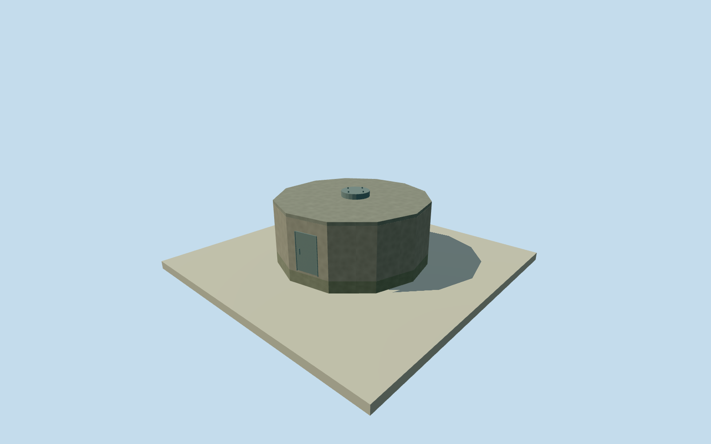

# Murchison northwest equipment base

Whole original12corner independently mapped antenna/equipment baseway632829123. Nativebuilding=yes/descriptionantenna-base-containingequipment establishes only mappedbody/role. Completeoutsidebody/roof/base/serviceaccess retained; exactheight/roof/finish/upperapparatus/facing and2013survival unverified. No sameidentitywith36ASKAPantennas; nearestactualASKAPpoint372.67maway. No upperantenna invented or assertedabsent, and no wholeobservatoryproxy. Underlying imageryprovider tag retained as numericalODbLattribution only; no sourcepixels used. All12originaloutsidecorners andwholewalls/closedroof/foundation/serviceaccessretained. Concretebody/flatcap/closedmountingboss/door/vent/anchors are exterior estimates,not sourceobservations. Height/roof uncertainty2m, mounting/access/detail uncertainty.5m. Originalnativepolygon is not replaced by a fittedcircle. Upperantennaidentity/form and2013survivalunverified; upperapparatus is not invented or claimedabsent. Own256m129x129field16641values/2rawtiles/datum365.9835m frozenbeforefloor.15/foundation-.4/eave2/roofcap2.12/mounttop2.32. No sourceframe/field/floor/mainsection cut/mask/flatten/reframe/refitforrenders; groundcontactandabsolute/historicverticalties approximate. Qualla-first4families/1conflictunchanged. Allappearanceimageryunused. OriginalnumericalOSM12cornerbuilding/antenna-base-containingequipmentrecord only, creditedODbL. Originalunderlyingimageryprovidertagretainedwithoutfetching/viewing/copyingpixels. No sourcephoto/figure/plan/diagram/map/satelliteimage adopted. Descriptivegeographicname; not a particular namedantenna or oneof36ASKAPdishes. Approximate2013phase/currentWorldEligiblefalse withunverifiedhistoricalsurvival. No fulltower/dish or wholeobservatorycompletioncredit; acceptedmembers unchanged.

Authoring state: **review-in-qa.json**. Current completion evidence is in [qa.json](qa.json) and the [completion ledger](../../../../qualla-structures/batches/qualla-002.PROGRESS.md).

- [Murchison Radio-astronomy Observatory](https://qualla.com/murchison-radio-astronomy-observatory/)

Whole original12corner independently mapped antenna/equipment baseway632829123. Nativebuilding=yes/descriptionantenna-base-containingequipment establishes only mappedbody/role. Completeoutsidebody/roof/base/serviceaccess retained; exactheight/roof/finish/upperapparatus/facing and2013survival unverified. No sameidentitywith36ASKAPantennas; nearestactualASKAPpoint372.67maway. No upperantenna invented or assertedabsent, and no wholeobservatoryproxy. Underlying imageryprovider tag retained as numericalODbLattribution only; no sourcepixels used.

All12originaloutsidecorners andwholewalls/closedroof/foundation/serviceaccessretained. Concretebody/flatcap/closedmountingboss/door/vent/anchors are exterior estimates,not sourceobservations. Height/roof uncertainty2m, mounting/access/detail uncertainty.5m. Originalnativepolygon is not replaced by a fittedcircle. Upperantennaidentity/form and2013survivalunverified; upperapparatus is not invented or claimedabsent.

Own256m129x129field16641values/2rawtiles/datum365.9835m frozenbeforefloor.15/foundation-.4/eave2/roofcap2.12/mounttop2.32. No sourceframe/field/floor/mainsection cut/mask/flatten/reframe/refitforrenders; groundcontactandabsolute/historicverticalties approximate.

Qualla-first4families/1conflictunchanged. Allappearanceimageryunused. OriginalnumericalOSM12cornerbuilding/antenna-base-containingequipmentrecord only, creditedODbL. Originalunderlyingimageryprovidertagretainedwithoutfetching/viewing/copyingpixels. No sourcephoto/figure/plan/diagram/map/satelliteimage adopted.

Descriptivegeographicname; not a particular namedantenna or oneof36ASKAPdishes. Approximate2013phase/currentWorldEligiblefalse withunverifiedhistoricalsurvival. No fulltower/dish or wholeobservatorycompletioncredit; acceptedmembers unchanged.

Build: `node content/worldgen/source/places/qe/qe6/murchison_northwest_equipment_base/models/generate-house.mjs`. Add `--check` to verify exact regeneration. 440 triangles; 5 materials; no embedded photographs.
