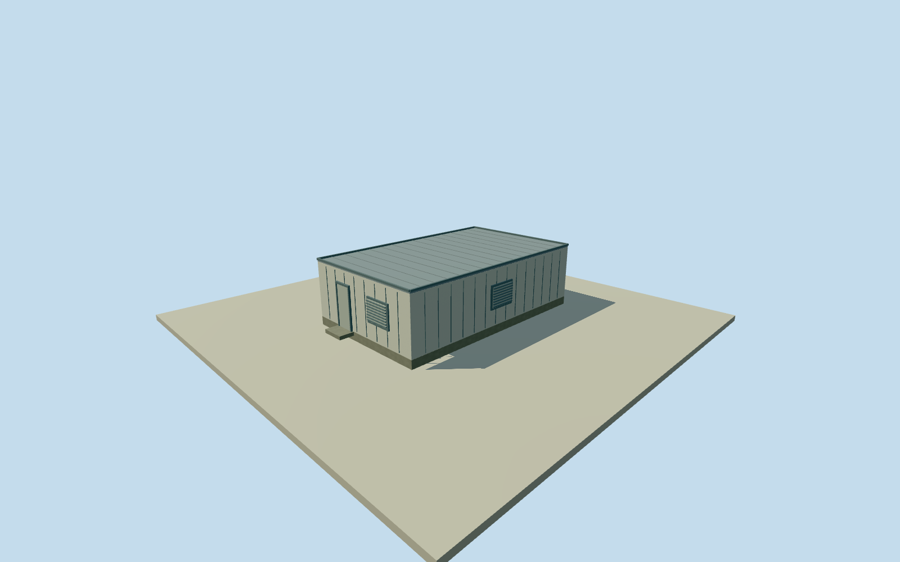

# Murchison western support building, north

Whole independently mapped buildingway629781192 west of the main MRO control building. All originalfourcorners/walls/full flat roof/base/closedentry/exteriorvents retained. Descriptive geographicaltitle; actualprecisefunction unknown. Height/flat roof/doors/ventilation/metal finish/2013 phase estimates explicit. Every image unused.

Authoring state: **review-in-qa.json**. Current completion evidence is in [qa.json](qa.json) and the [completion ledger](../../../../qualla-structures/batches/qualla-002.PROGRESS.md).

- [Murchison Radio-astronomy Observatory](https://qualla.com/murchison-radio-astronomy-observatory/)

Whole independent building way629781192 west of the main MRO control building: all original four corners/allwalls/fullroof/base/closedentry/exteriorventilation. Height/roof/facade/finish and2013retrospective phase are estimates; every image unused. Descriptive name only; precise function unestablished. Parent observatory remains incomplete until whole declared coverage is complete.

Whole original way629781192 complete four-corner envelope/footprint-centre/first-edge axis retained, allwalls/fullroof/base/closedentry/externalventilation. Independent asset andplacement, never maincontrolbuilding orwholeobservatory proxy. Descriptive title only; precise function/official name unestablished. Currentmappedfootprint approximates2013; constructiondate notasserted.

Original256m129x129 field/16641 heights/2 rawtiles, datum373.946m/range368.6631..375.3679m acquired before floor/mainsections/geometry. Floor.15m/base-.4m/eaves2.95m/roof3.03m/parapet3.12m chosenonce afterfield. Originalframe/field/floors/mainsections never cut/masked/flattened/refetched/refitted for captures. Providergrade/contact approximations remain; no surveyedverticalregistration.

One-storey form, flat metalroof/cladding, exteriorheight/door/ventilation/servicefinish and2013retrospectiveappearance are original estimates,1.5mheight/2mcomponentuncertainty. Fullphysicalbody/allroof/elevations remain; no hiddeninternal/electrical/shielding/workingperformance reconstruction. No sourcephotographicfidelity claimed.

Qualla first4imagefamilies/1metadata conflict, everyimageunused. Original provider numerical buildingplan/type only, source tags retained withODbLcredit. No commercialphoto/map/figure/diagram downloaded/viewed/traced, questionableimage orrightsrepair.

Approximate2013 datedproposal/currentWorldEligible false. FourLODs retainentirebuilding/roof/base/entry/vents; roofseams/claddingjoints/grillebars reduce atdistance. Otherindependentmappedbuildings andentireASKAP/MWA/EDGEScoverage remainseparate.

Build: `node content/worldgen/source/places/qe/qe6/murchison_west_service_building_north/models/generate-house.mjs`. Add `--check` to verify exact regeneration. 1200 triangles; 5 materials; no embedded photographs.
