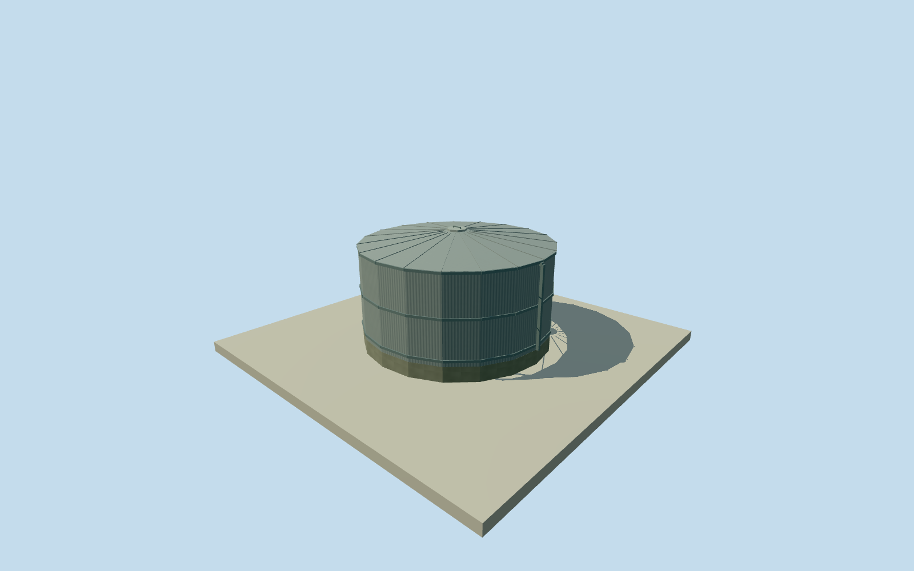

# Murchison western water tank

Whole separately mapped western water-storage tankway618004590: complete original19corner near-circular envelope/allwalls/closedroof/base/accesslid. Native man_made=storage_tank/content=water establish function; exact height/roof/material/finish/capacity and2013survival are unverified estimates. Descriptive geographic name, no named observatory instrument or whole-site proxy. All imagery unused; original numerical OSM data and attribution only. All original19outside controls retained at everyLOD. Native footprint and water-storage tags establish horizontal extent/function only. Approximate cylindrical tank is modeled on the near-circular native polygon, not a fitted replacement circle or site-boundary extrusion. Capacity, exact construction year and2013survival unverified. Independent256m129x129field/16641heights/1rawtile/datum365.4231m fixed before floor.15m/base-.4m/eave2.6m/roofapex2.95m. No field/frame/floor/mainsection cut/mask/flatten/refetch/refit. Composite DEM contact/verticaltie and historic ground unknown; source grade may obscure or expose lower skirt. Estimated2.45m wall above floor and shallow conical closed roof, corrugated steel finish, three reinforcing collars, small central accesslid and short side service pipe. Exact height/roof material/finish/collar count/lid/pipe form/facing are estimates,1.5m height/.5m component uncertainty. No working plumbing, internal capacity or electrical systems asserted. Full native body/roof/base/accesslid/servicepipe persist at allLODs; roof seams and lid hardware simplify. Qualla-first4families/1conflict previously screened. Every source photograph, figure, diagram, plan, texture and image-derived appearance unused. Original numerical OSM footprint and water/storage tags only, creditedODbL. No uncertain image or source metadata change. Approximate2013dated visualization/currentWorldEligiblefalse, without independently verified2013survival. Independent structure/placement, no main control building/instrument or whole-observatory proxy. All accepted observatory assets, original fields/frames/floors and QA unchanged.

Authoring state: **review-in-qa.json**. Current completion evidence is in [qa.json](qa.json) and the [completion ledger](../../../../qualla-structures/batches/qualla-002.PROGRESS.md).

- [Murchison Radio-astronomy Observatory](https://qualla.com/murchison-radio-astronomy-observatory/)

Whole separately mapped western water-storage tankway618004590: complete original19corner near-circular envelope/allwalls/closedroof/base/accesslid. Native man_made=storage_tank/content=water establish function; exact height/roof/material/finish/capacity and2013survival are unverified estimates. Descriptive geographic name, no named observatory instrument or whole-site proxy. All imagery unused; original numerical OSM data and attribution only.

All original19outside controls retained at everyLOD. Native footprint and water-storage tags establish horizontal extent/function only. Approximate cylindrical tank is modeled on the near-circular native polygon, not a fitted replacement circle or site-boundary extrusion. Capacity, exact construction year and2013survival unverified.

Independent256m129x129field/16641heights/1rawtile/datum365.4231m fixed before floor.15m/base-.4m/eave2.6m/roofapex2.95m. No field/frame/floor/mainsection cut/mask/flatten/refetch/refit. Composite DEM contact/verticaltie and historic ground unknown; source grade may obscure or expose lower skirt.

Estimated2.45m wall above floor and shallow conical closed roof, corrugated steel finish, three reinforcing collars, small central accesslid and short side service pipe. Exact height/roof material/finish/collar count/lid/pipe form/facing are estimates,1.5m height/.5m component uncertainty. No working plumbing, internal capacity or electrical systems asserted. Full native body/roof/base/accesslid/servicepipe persist at allLODs; roof seams and lid hardware simplify.

Qualla-first4families/1conflict previously screened. Every source photograph, figure, diagram, plan, texture and image-derived appearance unused. Original numerical OSM footprint and water/storage tags only, creditedODbL. No uncertain image or source metadata change.

Approximate2013dated visualization/currentWorldEligiblefalse, without independently verified2013survival. Independent structure/placement, no main control building/instrument or whole-observatory proxy. All accepted observatory assets, original fields/frames/floors and QA unchanged.

Build: `node content/worldgen/source/places/qe/qe6/murchison_western_water_tank/models/generate-house.mjs`. Add `--check` to verify exact regeneration. 1163 triangles; 5 materials; no embedded photographs.
