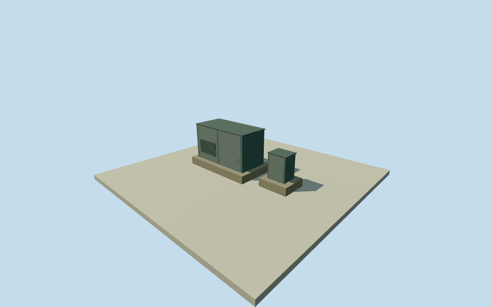

# Murchison Widefield Array distribution hub

Whole MWA power/data distribution hub: two separate adjacent concrete plinths, compact transformer/LVswitchboardkiosk on one and fibre-patch environmental enclosure on the other. Whole smallapparatus ensemble, not a donga, separateCPF or onecabinetproxy. Written original2012engineeringfacts only; allappearanceimageryunused. Hubpointderivedfromwritten(0,-200)mcaption andnumericarrayorigin, approximately200msouth; no native/surveyedhubpointclaim.50m nominalpositionallowance and180degfacinguncertainty are authorallowances,notmeasurederrorbounds. Cabinet/padsections/spacing/finish and2012-to2013continuity remain estimates, selectedonlyafter ownfield. Allwholeprimaryapparatuspresent: compactsubstationenclosure representingcontainedtransformer/LVswitchboard ononecompleteconcreteplinth, separatefibrepatchenvironmentalcabinetonadjacentcompleteplinth. No singlecabinet/dongaproxy; belowgroundcables/internaltransformer/electronicsnotmodeled. Externalsectionsareauthor estimates: powerplinth4.6x2.6m andpatchplinth1.8x1.6m; substationkiosk4x1.9x2.2m, patchcabinet1.1x.9x1.45m. Width/height uncertainty2m; cabinetspacing2m; panelvent/door/handle/roofcap/material/finish details.5m uncertain,not measuredengineeringdimensions. Closeddoors andestimatedventslatsretainexteriorweatherhousing; no workingelectrical/safetyclearanceclaim. Own256m129x129field16641heights/1rawtile/datum383.0885m frozen beforefloor.2/padbottom-.4/kiosk2.4/patch1.65m. Originalframe/field/floors/mainsectionsnevercut/masked/flattened/reframed/refitted forrenders. CoarsecompositeDEMcontact/2013gradeandabsolutetieunverified. Qualla-first4families/1conflict,allappearanceimagesunused. Originalpaperwrittenapparatus/two-plinthrelationship/approx200msouth andnumericarrayorigin only; everyfigure/graphicpath/photo/diagram/plan/map/satellitepixelunused. Approximate2013continuityfrom2012/currentWorldEligiblefalse. No acceptedmembergeometry,fields,frames,floors orQAchanged. Wholeparentunfinished.

Authoring state: **review-in-qa.json**. Current completion evidence is in [qa.json](qa.json) and the [completion ledger](../../../../qualla-structures/batches/qualla-002.PROGRESS.md).

- [Murchison Radio-astronomy Observatory](https://qualla.com/murchison-radio-astronomy-observatory/)

Whole MWA power/data distribution hub: two separate adjacent concrete plinths, compact transformer/LVswitchboardkiosk on one and fibre-patch environmental enclosure on the other. Whole smallapparatus ensemble, not a donga, separateCPF or onecabinetproxy. Written original2012engineeringfacts only; allappearanceimageryunused. Hubpointderivedfromwritten(0,-200)mcaption andnumericarrayorigin, approximately200msouth; no native/surveyedhubpointclaim.50m nominalpositionallowance and180degfacinguncertainty are authorallowances,notmeasurederrorbounds. Cabinet/padsections/spacing/finish and2012-to2013continuity remain estimates, selectedonlyafter ownfield.

Allwholeprimaryapparatuspresent: compactsubstationenclosure representingcontainedtransformer/LVswitchboard ononecompleteconcreteplinth, separatefibrepatchenvironmentalcabinetonadjacentcompleteplinth. No singlecabinet/dongaproxy; belowgroundcables/internaltransformer/electronicsnotmodeled.

Externalsectionsareauthor estimates: powerplinth4.6x2.6m andpatchplinth1.8x1.6m; substationkiosk4x1.9x2.2m, patchcabinet1.1x.9x1.45m. Width/height uncertainty2m; cabinetspacing2m; panelvent/door/handle/roofcap/material/finish details.5m uncertain,not measuredengineeringdimensions. Closeddoors andestimatedventslatsretainexteriorweatherhousing; no workingelectrical/safetyclearanceclaim.

Own256m129x129field16641heights/1rawtile/datum383.0885m frozen beforefloor.2/padbottom-.4/kiosk2.4/patch1.65m. Originalframe/field/floors/mainsectionsnevercut/masked/flattened/reframed/refitted forrenders. CoarsecompositeDEMcontact/2013gradeandabsolutetieunverified.

Qualla-first4families/1conflict,allappearanceimagesunused. Originalpaperwrittenapparatus/two-plinthrelationship/approx200msouth andnumericarrayorigin only; everyfigure/graphicpath/photo/diagram/plan/map/satellitepixelunused. Approximate2013continuityfrom2012/currentWorldEligiblefalse. No acceptedmembergeometry,fields,frames,floors orQAchanged. Wholeparentunfinished.

Build: `node content/worldgen/source/places/qe/qe6/murchison_widefield_array_distribution_hub/models/generate-house.mjs`. Add `--check` to verify exact regeneration. 732 triangles; 6 materials; no embedded photographs.
