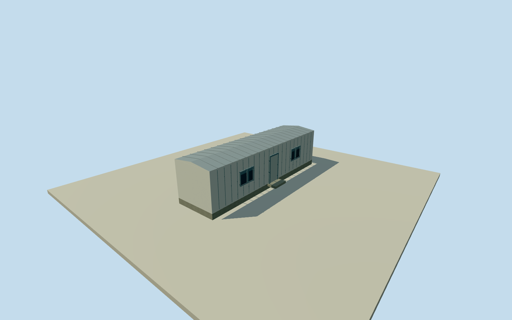

# Murchison Widefield Array field donga

Whole named MWA Donga: original four-corner numerical building footprint, all walls, entire estimated shallow gable roof/base/closed entry/four closed windows/attached service unit. Height, roof, facade, finish and2013retrospective phase estimates explicit. Independent geographic building, never a substitute for the whole observatory.

Authoring state: **review-in-qa.json**. Current completion evidence is in [qa.json](qa.json) and the [completion ledger](../../../../qualla-structures/batches/qualla-002.PROGRESS.md).

- [Murchison Radio-astronomy Observatory](https://qualla.com/murchison-radio-astronomy-observatory/)

Whole independent MWA field donga: all original four corners, all exterior walls, full roof, base, closed entry, windows and estimated intrinsic service unit. Current mapped footprint retained; height/one-storey form/roof/facade/services/finish and retrospective2013phase estimated. No imagery used; never a proxy for the whole observatory.

Exact original named MWA Donga/way629792391 complete four-corner ring and footprint-centre/axis retained as independent model and placement. Native numeric data ODbL attribution preserved, including original source tags; no provider imagery adopted. Current mapped building approximates2013; actual construction date and exact historic appearance unestablished.

Original256m129x129 field/16641 heights/1 rawtiles datum378.3893m/range377.7116..383.2948m fixed before floor/mainsections/geometry. Floor.15m/base-.4m/eaves2.95m/ridge3.15m chosen once after field; originalframe/field/floors/mainsections never cut/masked/flattened/refetched/refitted for captures. Coarseprovidergrade can affect visiblebase/steps; no surveyedcontact orverticalregistration claim.

Whole independent building with allwalls/fullnativeplan/fullshallowgableroof/base/closedentry/fourclosedwindows/attachedestimatedservicebox/entrypad. Roof/one-storey form/facade/door/windowcensus/services/metalcladding/finish are original estimates,1mheight/2mcomponentuncertainty. No internal rooms or exact shielding/performance claims.

Qualla first4imagefamilies/1conflict, every image unused. Original provider numerical plan/name/buildingtype only; no photo/figure/map/diagram adopted, no rightsrepair orquestionable source imagery. Plane/height/detail fidelity remains bounded accordingly.

Approximate2013 datedproposal/currentWorldEligible false. All intrinsic exteriorparts retained at fourLODs; finer panels/windowframes/roofseams reduce atdistance. This independentdonga never standsfor thewholeobservatory; controlbuilding/ASKAP36/MWA128/EDGES/otherrequiredsupportcoverage remain separately tracked.

Build: `node content/worldgen/source/places/qe/qe6/murchison_widefield_array_donga/models/generate-house.mjs`. Add `--check` to verify exact regeneration. 1434 triangles; 6 materials; no embedded photographs.
