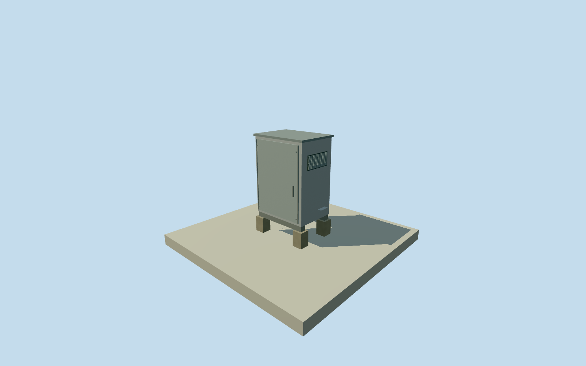

# Murchison Widefield Array receiver

Whole originalMWAweather-tightRFshieldedreceiverenclosurewithintegratedrefrigeration, rackrepresentedinsideclosedweatherhousing andintrinsicsupport/serviceentry. Externaldimensions/finish/facing/coolingunitlayoutunmeasured, tobeexplicitlyestimatedafter ownfield. Onecabinettypeintendedfor16identified2013receivergroups; repeatedinstancesarenotextraassetcompletioncredit. RepresentativeRx11pointisderivedconstraintchoice,notnative/surveyedposition;conditionalregion~43m isnotactualgroundtrutherrorbound. Other15instancesneedindividualexplicitestimates. Allappearanceimageryunused;Qualla-first4families/1conflictpreserved. Wholeobservatoryseparate. Actualoriginal2013configuration binds16receiverIDs/eighttiles each; onewholecabinetgeometryreusedwith16distinctexplicitlyinferredplacements. No arbitrarymappedbuilding isrelabeledasareceiver. Eighttilecoordinatesarenotreceivercoordinates. Candidatepositionsfromconservativeconditionalrangeintersection areoriginalauthorchoices,not surveyedoperatorpoints ortrueerrorbounds; allper-instanceconditionalradii retained. OwnrepresentativeRx11original256m129x129field16641heights/oneoriginaltile/datum377.4826m frozen beforefoundation-.35..+.15/skid.15..+.3/cabinetfloor.3/top2.4/roofcap2.455m. No field/frame/floor/mainsectioncut/mask/flatten/reframe/refitforrenders. Otherreceiverinstancesuseunchangedoriginalwhole-sitefield/retainedrawtiles, with theirderiveddatumsfixedbeforeplacement, notsurveyedverticalties. Wholeweather-tightRFshieldedelectronicsreceiverenclosurewithintegratedrefrigeration representedbyclosedmainweatherhousing,closedfrontdoor/rearcoolingaccesscover/estimatedvents/serviceentry/topweathercap/steelbase/fourpadfootings. Rack/electronics/refrigerationmechanisminternalandnotmodeled. Externalmainbody1.6x1.15x2.1m, pad.28square/baselegpositions/door/coolingcover/ventcensus/handles/finish/facing areauthorestimates,notmeasuredsourceform. Height/width1m uncertainty/supports/details.5m; nominal180degfacinguncertainty. No electrical/RFIperformance or construction-clearanceclaim. Original2012engineeringpaperwrittensection2.4states rackinweather-tightRFshieldedenclosurewithintegratedrefrigeration; actual2013configurationprovidesconnectivity/positionsofconnectedtiles/effectivelengths only. Everyphoto/figure/graphicpath/plan/map/satellitepixelunused. Effectiveelectrical lengthatc isnotphysicalrouteandclock-adjustedtedisnotlength/height. No sourceimage adopted. Qualla-first4families/1conflictunchanged. Approximate2013visualization/currentWorldEligiblefalse; oldacceptedMROgeometry/fields/frames/floors/QAunchanged. Wholeobservatoryseparate; repeatedinstancesnotadditionalassetcompletioncredit.

Authoring state: **review-in-qa.json**. Current completion evidence is in [qa.json](qa.json) and the [completion ledger](../../../../qualla-structures/batches/qualla-002.PROGRESS.md).

- [Murchison Radio-astronomy Observatory](https://qualla.com/murchison-radio-astronomy-observatory/)

Whole originalMWAweather-tightRFshieldedreceiverenclosurewithintegratedrefrigeration, rackrepresentedinsideclosedweatherhousing andintrinsicsupport/serviceentry. Externaldimensions/finish/facing/coolingunitlayoutunmeasured, tobeexplicitlyestimatedafter ownfield. Onecabinettypeintendedfor16identified2013receivergroups; repeatedinstancesarenotextraassetcompletioncredit. RepresentativeRx11pointisderivedconstraintchoice,notnative/surveyedposition;conditionalregion~43m isnotactualgroundtrutherrorbound. Other15instancesneedindividualexplicitestimates. Allappearanceimageryunused;Qualla-first4families/1conflictpreserved. Wholeobservatoryseparate.

Actualoriginal2013configuration binds16receiverIDs/eighttiles each; onewholecabinetgeometryreusedwith16distinctexplicitlyinferredplacements. No arbitrarymappedbuilding isrelabeledasareceiver. Eighttilecoordinatesarenotreceivercoordinates. Candidatepositionsfromconservativeconditionalrangeintersection areoriginalauthorchoices,not surveyedoperatorpoints ortrueerrorbounds; allper-instanceconditionalradii retained.

OwnrepresentativeRx11original256m129x129field16641heights/oneoriginaltile/datum377.4826m frozen beforefoundation-.35..+.15/skid.15..+.3/cabinetfloor.3/top2.4/roofcap2.455m. No field/frame/floor/mainsectioncut/mask/flatten/reframe/refitforrenders. Otherreceiverinstancesuseunchangedoriginalwhole-sitefield/retainedrawtiles, with theirderiveddatumsfixedbeforeplacement, notsurveyedverticalties.

Wholeweather-tightRFshieldedelectronicsreceiverenclosurewithintegratedrefrigeration representedbyclosedmainweatherhousing,closedfrontdoor/rearcoolingaccesscover/estimatedvents/serviceentry/topweathercap/steelbase/fourpadfootings. Rack/electronics/refrigerationmechanisminternalandnotmodeled. Externalmainbody1.6x1.15x2.1m, pad.28square/baselegpositions/door/coolingcover/ventcensus/handles/finish/facing areauthorestimates,notmeasuredsourceform. Height/width1m uncertainty/supports/details.5m; nominal180degfacinguncertainty. No electrical/RFIperformance or construction-clearanceclaim.

Original2012engineeringpaperwrittensection2.4states rackinweather-tightRFshieldedenclosurewithintegratedrefrigeration; actual2013configurationprovidesconnectivity/positionsofconnectedtiles/effectivelengths only. Everyphoto/figure/graphicpath/plan/map/satellitepixelunused. Effectiveelectrical lengthatc isnotphysicalrouteandclock-adjustedtedisnotlength/height. No sourceimage adopted.

Qualla-first4families/1conflictunchanged. Approximate2013visualization/currentWorldEligiblefalse; oldacceptedMROgeometry/fields/frames/floors/QAunchanged. Wholeobservatoryseparate; repeatedinstancesnotadditionalassetcompletioncredit.

Build: `node content/worldgen/source/places/qe/qe6/murchison_widefield_array_receiver/models/generate-house.mjs`. Add `--check` to verify exact regeneration. 576 triangles; 6 materials; no embedded photographs.
