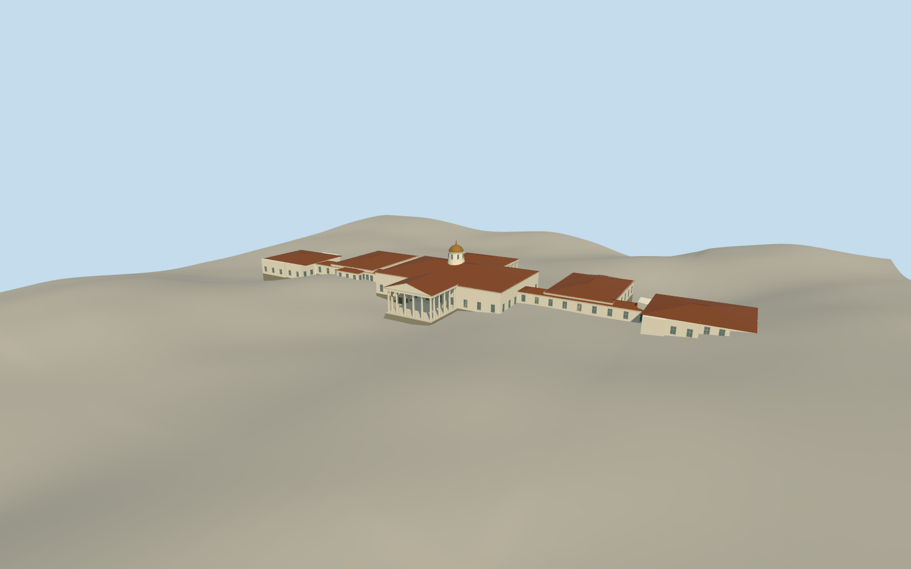

# Bogor Palace

The present Bogor Palace with white ceremonial colonnades, red roof ranges, two connected wings and the gold-topped central cupola.

Authoring state: **review-in-qa.json**. Current completion evidence is in [qa.json](qa.json) and the [completion ledger](../../../../qualla-structures/batches/qualla-003.PROGRESS.md).

- [Bogor Palace](https://qualla.com/bogor-palace/)

Roof ridges, window and column cadence away from the photographed façade, exact condition of the far wings and absolute floor elevations are medium-fidelity approximations.

This is the standing palace and its connected ranges. The detached Balai Kirti building, the botanical estate, interiors, fences and gardens are outside the exterior scope.

Build: `node content/worldgen/source/places/qq/qqg/bogor_palace/models/generate-bogor-palace.mjs`. Add `--check` to verify exact regeneration. 8435 triangles; 6 materials; no embedded photographs.
