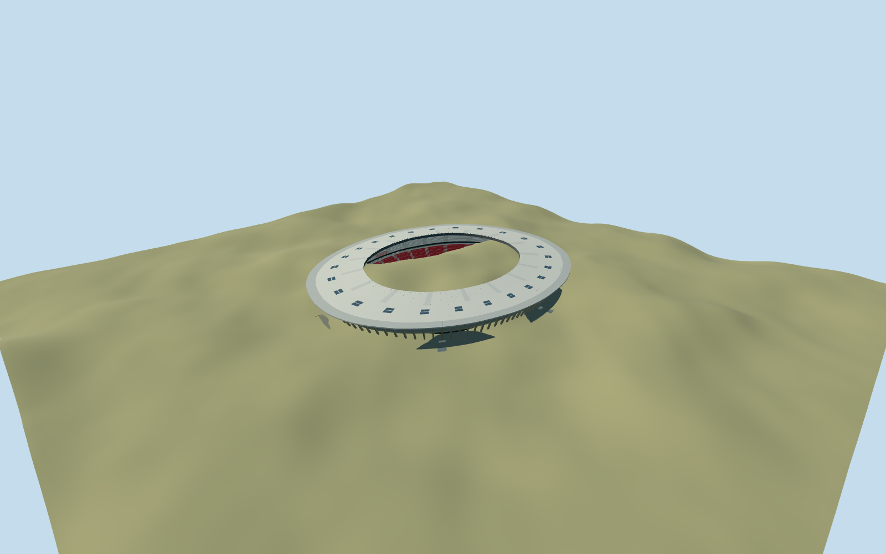

# Gelora Bung Karno Stadium

Jakarta’s main stadium, with a pale continuous temu gelang canopy, tiered red and white seating and an open concrete colonnade around the football pitch and running track.

Authoring state: **review-in-qa.json**. Current completion evidence is in [qa.json](qa.json) and the [completion ledger](../../../../qualla-structures/batches/qualla-003.PROGRESS.md).

- [The Stadium That Sukarno Willed Into Being](https://qualla.com/gelora-bung-karno-stadium/)

The outer stadium, track and grass boundaries are mapped. The roof opening, section heights, repetitive fascia, gate geometry and roof bracing are approximate.

The 2005 photograph predates the 2018 renovation. The permanent ring and concrete tiers follow the photograph, with post-renovation red and white seating based on written operator and government descriptions.

The sports surface is vertically estimated from ground outside the southern perimeter. Original data are preserved and the model clears the built bowl only.

The field markings, photovoltaic panels and seating are represented in aggregate. The scope is the named main stadium, excluding neighboring Gelora sports facilities and signage.

Build: `node content/worldgen/source/places/qq/qqg/gelora_bung_karno_stadium/models/generate-gelora-bung-karno-stadium.mjs`. Add `--check` to verify exact regeneration. 27388 triangles; 5 materials; no embedded photographs.
