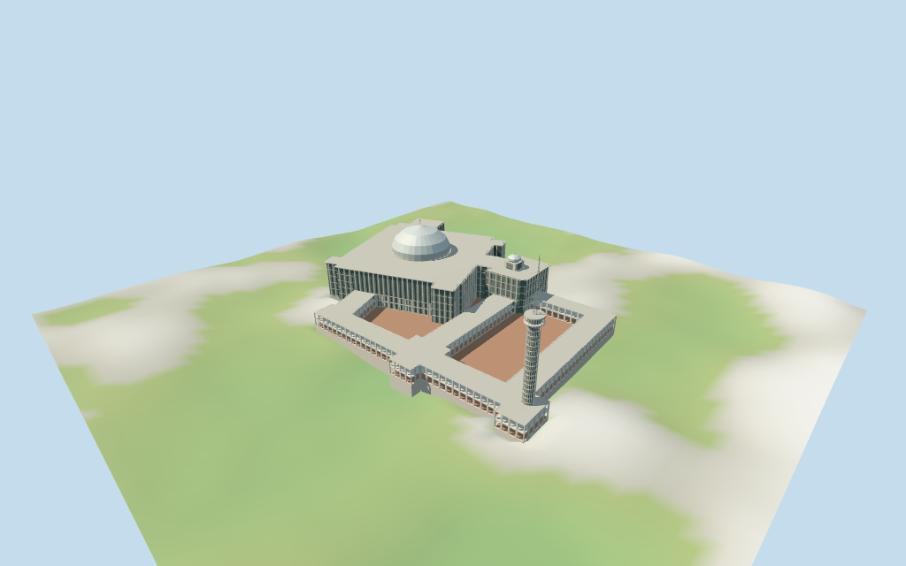

# Istiqlal Mosque

Individual medium-fi Istiqlal Mosque with exact retained outer and internal mapped controls:angled monumental main hall/connector and smaller entry block,large shallow pale dome with finial,smaller bulb dome on square windowed drum,one grid-sided minaret with flared balcony and open tapered lattice pinnacle,raised deck,two open courtyards and two-storey rectangular colonnades. Shared materials,four complete browser LODs;fine motifs,exact facade/grid cadence,stairs,unseen interiors,current vines/finish and precise terrain joins remain approximate or omitted.

## Evidence and reconstruction

Published dimensions and reconstructed details are separated in spec.json. Primary references:

- [Reference](https://www.indonesia.travel/id/id/travel-ideas/pilgrimage/masjid-istiqlal)
- [Reference](https://commons.wikimedia.org/wiki/File:Inner_courtyard_of_the_Masjid_Istiqlal_Jakarta.jpg)
- [Reference](https://commons.wikimedia.org/wiki/File:Minaret_(30320253562).jpg)

Five existing shared256² marble,concrete,beadblasted stainless,perforated square metal and clay graphs;seven merged roles. Metric UVs,linear tints,no embedded images,unique atlases,copied artwork or baked lighting.

## Model and axes

20,201 triangles; 60,603 vertices; 7 material groups; 2,428,556 bytes. Native bounds: -123.080, -7.522, -85.007 to 120.881, 94.659, 83.852. Source hash: `sha256:9a0300ad165bbfc940a0bc4fe0901257fd78151e986ea0123773f75176642f9d`.

{"x":"retained long overall map axis;main hall remains angled within it","y":"up","z":"retained perpendicular axis;court holes and mapped minaret fixed"}

Standard viewer DEM datum 7.175377200283473m. Floor -2.0039712667455456m is median of 452 outside-perimeter samples every2m at1m offset plus0.25m. Whole-site raw DEM range -7.175377200283473..4.1573731929048225m. Raised5m deck is an architectural visualization assumption;not a surveyed court level. Visible-model terrain cutout follows mapped outer boundary;modeled plinth/deck resolve site DEM interference. Preview101² grid is locally seated beneath that boundary;raw161² DEM retained separately. Exact exterior street/approach/threshold joins and vertical datum bias remain unverified.

## Reproduce

Run `node packages/worldgen/scripts/generate-additional-landmarks.mjs --ids=istiqlal_mosque` (or add `--check`). The generator preserves manually edited masters by checking their baseline hashes. Import through the standard authored-model workflow with optimization disabled; then capture all QA cameras, including shared-surface views.

## Pending work

- Retained exact relation/9627236 /Q475379 matches current whole52776567760484 (3*2^44+9627236). Six current building controls retain whole41 outer vertices/two courtyard holes,40-point main mass,8-point inner hall,32-point main dome,16-point smaller dome and8-point minaret. Original anchor[106.831136364,-6.170251873] and heading−0.816894039679rad unchanged. Main hall axes remain angled relative to the long courtyard ranges;no forced global rectangle or horizontal rescale. Current names/tags are retained separately from prior multilingual exact identity. Main/small dome and minaret centers derive from their map bounds. Specific facade rhythm,stairs and vertical partitions are picture-proportioned estimates.
- Retained facts have no height,width or length statements. Current map tags:whole5m,main mass66.66m,inner hall5m,main dome5m,small dome5m,minaret96.66m;all raw tags retained. These overlapping tags do not form a coherent set of absolute roof elevations. Use approximate5m raised deck,15.4m two-storey gallery roof,32.65m main/entry roof and34m main dome spring. Main dome uses its47m mapped span with estimated20m rise and58.8m finial top;smaller mapped dome gets estimated4m windowed drum and5m cap rise. The66.66m mass tag is not used as a flat main roof;it conflicts with the inspected form. Minaret96.66m total is retained,with estimated66.66m balcony/spire partition. No min_height controls establish these vertical joins. Allow roughly4m roof-height uncertainty;precise stairs,rooms and current finish unverified.
- Standard viewer DEM datum 7.175377200283473m. Floor -2.0039712667455456m is median of 452 outside-perimeter samples every2m at1m offset plus0.25m. Whole-site raw DEM range -7.175377200283473..4.1573731929048225m. Raised5m deck is an architectural visualization assumption;not a surveyed court level. Visible-model terrain cutout follows mapped outer boundary;modeled plinth/deck resolve site DEM interference. Preview101² grid is locally seated beneath that boundary;raw161² DEM retained separately. Exact exterior street/approach/threshold joins and vertical datum bias remain unverified.
- Three useful exterior pictures guide vertical fins/five-storey screen rhythm,flat overhanging roof,large shallow dome and pole/ring finial,small bulb dome on square windowed drum,two-storey rectangular open colonnades and long grid-sided minaret with flared balcony/open lattice pinnacle. Large and small dome map rings and all court openings retained;distant rings coarsen with matching roof holes. Main hall/small drum windows close on opaque perforated-metal proxies;galleries remain spatially open,not a furnished/navigable interior. Minaret screen core and merged pale grid ribs abstract the many actual openings;skyline/district pinnacle is a solid tapered proxy,near is open lattice. Current vines,exact facade/pier cadence,stairs,fine artwork,precise vertical datum/thresholds,unseen rooms/roof details,engineering and physical-device performance unverified.

This bundle follows the medium-fi standard. Medium-fi appearance and geographic fit are reviewed separately. Hash-bound visual acceptance is recorded separately after capture inspection.

## Additional geographic data

©OpenStreetMap contributors;Protomaps;Mapzen/USGS terrain tiles.
