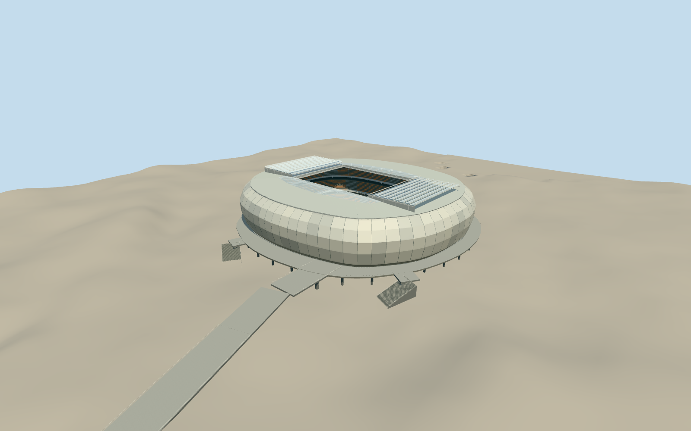

# Jakarta International Stadium

Jakarta International Stadium with its perforated steel bowl, broad pale roof, open retractable panels, three seating tiers and the elevated east and west approaches.

Authoring state: **review-in-qa.json**. Current completion evidence is in [qa.json](qa.json) and the [completion ledger](../../../../qualla-structures/batches/qualla-003.PROGRESS.md).

- [Jakarta International Stadium](https://qualla.com/jakarta-international-stadium/)

Standing stadium in the open-roof football configuration photographed on 17 November 2023. Roof modules are shown parked, with no moving parts. The licensed photograph informs the field, interior and the exposed roof structure. No photograph is embedded.

The named mapped building, elevated concourse, playing field, east ramp alignment and west ramp footprint determine the plan. The facade panel spacing, tiger-stripe perforation pattern, exact seat blocks, roof truss submembers and roof module parking positions are approximated from the published descriptions and dimensional controls.

The original 1024 m elevation field was acquired and frozen before authoring. The coarse dataset includes a deep anomalous return east of the stadium. Foundation depth, ramp gradients, concourse and pitch elevations are registered estimates. The nearby railway, bridge to the north and unattached training grounds are outside the model.

Build: `node content/worldgen/source/places/qq/qqg/jakarta_international_stadium/models/generate-jakarta-international-stadium.mjs`. Add `--check` to verify exact regeneration. 20468 triangles; 6 materials; no embedded photographs.
